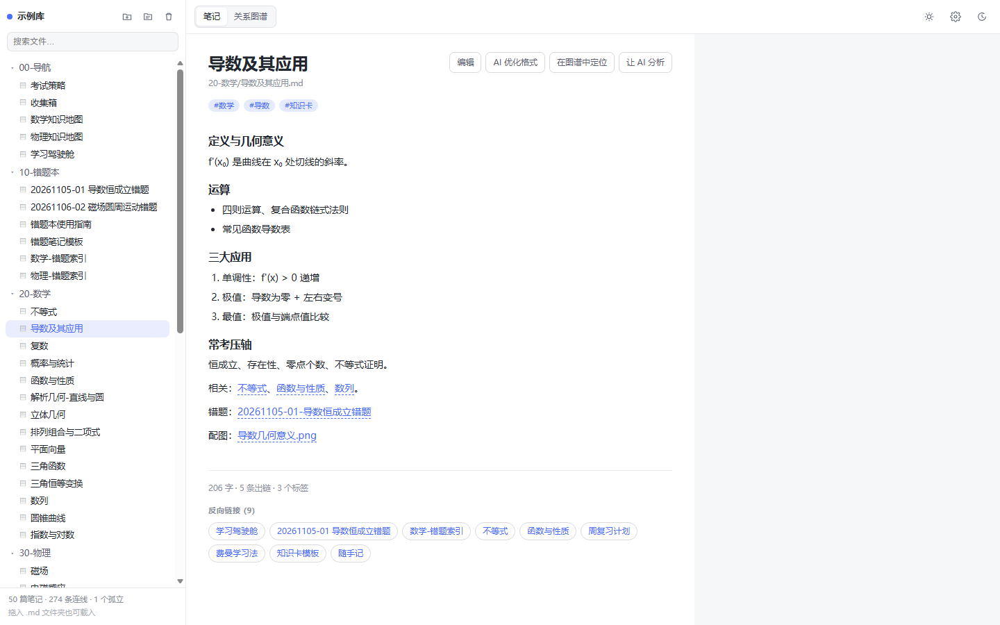
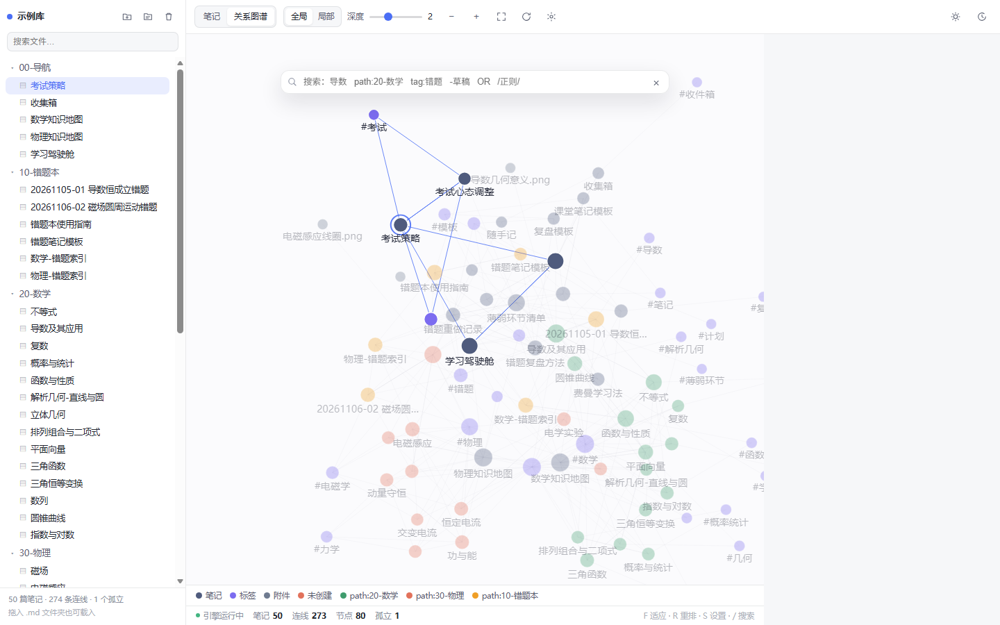

# 问墨笔记 · AI 笔记工作台


> 问墨笔记：会回答的本地 AI 笔记本
>
> 2026 第九届传智杯全国大学生数智创新与 AI 应用大赛 · AI 创新应用挑战赛参赛作品
>
> 一句话：**问墨笔记是一个以 AI 答疑为特色的本地笔记软件 —— 读你自己的 Markdown 库，把不会的题直接问「答疑老师」，解决完一键记入错题本，关系图谱只作辅助视图。**




---

## 1. 是什么

一个可以直接读写你本地 Markdown 笔记库的工作台：

- **笔记是主体**：左侧多级文件树，中间整页阅读 / 编辑，反向链接一目了然。
- **AI 答疑是特色**：右侧常驻面板，两个独立会话：
  - 「答疑老师」—— 像老师一样讲题，按考点 → 思路 → 分步推导 → 易错点输出，条件不足会先追问，支持多轮追问；
  - 「笔记问答」—— 只依据你的笔记回答，笔记里没有就明说。
- **错题闭环**：答疑结束会**单独再调一次模型**（`/api/analyze`）判定这道题「科目 + 错题类型 + 知识点」——错题类型固定为概念不清 / 计算失误 / 审题偏差 / 方法不会 / 公式记错 / 步骤遗漏 / 其他；**一道题可以有多个知识点（最多 5 个）**；随后自动归档到对应科目的错题本，标题写成「知识点 · 日期」，知识点以 `#标签` 写进正文供图谱与查询分类，错题类型单独一行；没有模型时用本地规则兜底；同一题不会重复记入。带图提问时，原题图片会压缩后存进 `10-错题本/图片/`，并在错题本里以 `### 原题图片` 内嵌显示。
  所有学科（含其他兜底）都会按需建立 10-错题本/<学科>/ 文件夹；旧版平铺错题本启动时自动迁入。
- **图谱是辅助**：随时切到关系图谱看结构，选中节点再回到笔记。

- **真数据**：读取真实 Markdown 库，解析 `[[双链]]`、`![[嵌入]]`、`#标签`、frontmatter 的 `title/tags/aliases`，生成节点与连线（不是硬编码的假数据）。
- **零运行时依赖**：纯 HTML + CSS + 原生 JavaScript + Canvas 2D，不用框架、不用打包器。
- **单文件交付**：`dist/Wenmo-Notes.html` 双击就能跑；笔记阅读、编辑、图谱全程离线，
  只有你主动使用 AI 答疑时，才会把相关笔记片段发给你自己配置的模型接口。
- **配套 AI 整理脚本**：按「只出建议稿、不改原文」的原则批量生成摘要 / 标签 / 双链建议。

---

## 2. 10 分钟极速复现

### 2.1 环境要求

| 项目 | 要求 |
| --- | --- |
| 操作系统 | Windows / macOS / Linux 均可 |
| 浏览器 | Chrome / Edge 90+（推荐，支持直接选文件夹）；Firefox / Safari 可用拖放方式 |
| Node.js | ≥ 20（仅开发、测试、构建和 AI 脚本需要；**只是想看图谱可以完全不装**） |
| 网络 | 只有 AI 问答与云同步需要出网；阅读、编辑、图谱全程离线 |

### 2.2 最快路径

**A. 桌面窗口模式（推荐，脱离浏览器）**

```
双击仓库根目录的：启动问墨笔记.bat
```

它会起一个本地服务，并用系统的 Edge / Chrome 以「应用模式」打开独立窗口：
没有浏览器地址栏和浏览器标签页、任务栏是独立图标，和日常浏览器互不干扰（用独立 profile 目录；应用内的笔记标签见功能清单）。

**B. Windows 单文件 exe（推荐分发用）**

```bash
npm run build:exe        # 生成 dist/Wenmo-Notes.exe
```

双击 `dist/Wenmo-Notes.exe` 即可：内置 Node 运行时，**目标机器不需要装 Node、也不需要浏览器命令行**。
它会起本地服务并自动打开 Edge/Chrome 应用窗口；exe 已切换为 GUI 子系统，双击不会弹黑色控制台窗口（找不到 Edge/Chrome 时自动调系统默认浏览器，启动信息写到 exe 同级 `data/startup.log`）。

- 用 Node 官方 SEA（Single Executable Application）打包，不依赖 Electron；构建后自动把 PE 子系统改成 GUI，避免黑框；
- 如果旧 `Wenmo-Notes.exe` 正在运行，`npm run build:exe` 会自动退到 `dist/Wenmo-Notes-NoConsole.exe`，不覆盖运行中的文件；
- 页面本体内嵌在 exe 里，记录写在 exe 同级的 `data/records.json`，浏览器 profile 在 `%LOCALAPPDATA%/Wenmo-Notes/browser-profile`，不再写进项目 `dist/profile/`；
- 端口被占用会自动往后找空闲端口；
- 想换浏览器：`set WENMO_BROWSER=C:/.../chrome.exe` 再运行。

**B2. Electron 桌面版（Obsidian 同款技术栈）**

Obsidian 本身是闭源商业应用，它的内核拿不到也用不了；但 Obsidian 用的底层就是 **Electron（Chromium + Node）**，
本项目提供同款架构的打包方式：

```bash
# 1) 先把 Electron 运行时放到 _tmp/electron（约 110MB，只需一次）
curl -L -o electron.zip https://registry.npmmirror.com/-/binary/electron/33.2.1/electron-v33.2.1-win32-x64.zip
unzip electron.zip -d _tmp/electron

# 2) 打包
npm run build:electron

# 已安装过，只更新页面代码（不重建运行时，应用运行中也可执行）
node scripts/build-electron.js --app-only
```

产物 `dist/Wenmo-Notes-Electron/Wenmo-Notes.exe`：真正的桌面窗口（无浏览器外壳、无地址栏），
内置 Node 主进程托管本地服务，数据写在 `%APPDATA%/Wenmo-Notes/data/`（旧版 `resources/app/app-data/` 会自动迁移）。整包约 268MB（Electron 本身就有 180MB）。

**C. 单文件 HTML（完全不启动服务）**

```
双击 dist/Wenmo-Notes.html
```

浏览器里打开，加载内置 50 篇示例库。AI 只能走本地分析，云同步与百度网盘代理不可用。

### 2.3 看自己的笔记（约 1 分钟）

1. 双击 `dist/Wenmo-Notes.html`；
2. 点左上角 **文件夹图标** → 选中你的 Markdown 笔记库目录（任何装着 `.md` 的目录都行）；
3. 浏览器授权后立即出图。

> 不支持 File System Access API 的浏览器：把整个笔记文件夹**拖进页面**，或点文件夹图标走 `<input webkitdirectory>` 兜底方案。

### 2.4 从源码运行与构建（约 3 分钟）

```bash
git clone https://gitee.com/ressoap/race-ai-note.git
cd race-ai-note
npm install            # 只装 jsdom（冒烟测试）、postject（exe 注入）、resedit（exe 图标）三个开发依赖
npm test               # 100 项单元测试（解析 / 查询 / 物理 / 服务端 / store 等）
npm run build          # 拼接 app/ai 片段并内联成 dist/Wenmo-Notes.html
```

打开 `index.html` 也能直接开发调试（浏览器直接加载 `js/*.js`，无打包器）。

### 2.5 启用 AI 问答（三种连接方式 + 两种人设）

先说明两个维度，别混在一起：

| 维度 | 选项 | 说明 |
| --- | --- | --- |
| 连接方式 | 本地代理 / 浏览器直连 / 只用本地分析 | 决定「能不能真正调用模型」 |
| 人设 | 答疑老师 / 笔记问答 | 决定「模型怎么回答」，两侧会话历史互不相通 |

**A. 本地分析模式（零配置，开箱即用）**

直接双击 `dist/Wenmo-Notes.html`，问答面板默认就是本地分析：不联网、不要密钥，
能回答「哪些笔记没被链接」「我的薄弱环节」「把这篇整理成知识卡」这类问题。

**B. 模型模式（需要密钥，密钥只在服务端）**

最省事的方式：key 写进本机 `.env`，服务启动时自动读取（`.env` 已被 `.gitignore` 排除，不会进仓库）。

```bash
cp .env.example .env      # 然后编辑 .env，填入 COMMAND_CODE_API_KEY
node scripts/serve.mjs    # 默认端口 4321，自动读取 .env
# 浏览器打开 http://localhost:4321
```

要识别图片，需要在 `.env` 里填 `AI_VISION_MODEL`（如 `gpt-4o` / `qwen-vl-max`），
或在设置窗口的「视觉模型」里填写；留空时会沿用文本模型，但文本模型通常无法识图。

也可以临时用环境变量（不落盘）：

```bash
$env:COMMAND_CODE_API_KEY="你的key"   # PowerShell
export COMMAND_CODE_API_KEY=你的key    # Git Bash / Linux / macOS
node scripts/serve.mjs --port 4321
```

**C. 在界面里填 Key（设置窗口）**

顶部工具栏齿轮图标（或按 `P`）打开设置窗口：

- **连接方式** 选「浏览器直连」→ 直接填 Key，只写进本浏览器 `localStorage`，不经任何服务器；
- 选「本地代理」→ 前端不碰 Key，用 `scripts/serve.mjs` 服务端的环境变量；
- 选「只用本地分析」→ 强制离线模式；
- 点「测试连接」会真实发一次极小请求验证连通性；点「拉取模型」从服务商拉取可用模型列表，填进下拉候选；「清除 Key」一键回到本地分析。

面板右上角出现「模型模式」即为生效；接口不通时会自动降级回本地分析，不会白屏。

可选环境变量：

| 变量 | 默认值 | 说明 |
| --- | --- | --- |
| `COMMAND_CODE_API_KEY` | （必填） | OpenAI 兼容接口密钥；也兼容 `AI_API_KEY`
| `AI_BASE_URL` | `https://api.deepseek.com/v1` | 接口地址，可换成任意兼容服务
| `AI_MODEL` | `deepseek-chat` | 模型名

**为什么密钥不能放前端：** 纯前端打包后密钥明文可见，任何人 F12 就能抄走。
所以模型调用一律走 `scripts/serve.mjs` 代理，前端只认识 `/api/chat` 这个相对路径。

### 2.6 批量整理脚本（可选）

```bash
node scripts/ai-organize.mjs --vault ./vault-example --dry-run   # 先看要处理哪些
node scripts/ai-organize.mjs --vault ./vault-example --limit 3   # 正式跑
```

输出落在 `<库目录>/_ai-建议稿/`，只写建议稿，原笔记一个字节都不动。

---

## 3. 桌面模式

应用本身是网页技术，但可以当成桌面程序来用。

| 方式 | 命令 | 特点 |
| --- | --- | --- |
| 桌面窗口（推荐） | 双击 `启动问墨笔记.bat` | 独立窗口、无地址栏、独立 profile、右键完全交给应用、AI 与云同步全可用 |
| 命令行启动 | `npm run desktop` | 同上，可加 `--port 4399` 换端口 |
| Electron 桌面版 | 双击 `dist/Wenmo-Notes-Electron/Wenmo-Notes.exe` | Obsidian 同款技术栈，真桌面窗口，整包 ~268MB |
| Windows exe（SEA） | 双击 `dist/Wenmo-Notes.exe` | 内置 Node，双击即用，体积 ~89MB |
| 单文件 HTML | 双击 `dist/Wenmo-Notes.html` | 零依赖零服务，但 AI 只能本地分析 |

> 从旧版升级：先退出正在运行的旧 Electron 实例，再双击新版；新版会沿用旧 userData 里的 localStorage，并把旧错题记录迁移到 `%APPDATA%/Wenmo-Notes/data/`。

`scripts/desktop.js` 做的事：

1. 起一个本地服务（`scripts/serve.mjs`，默认 4399 端口）；
2. 等它可用后，用 Edge/Chrome 的 `--app=` 模式打开，窗口独立；
3. 用 `%LOCALAPPDATA%/Race-AiNote/profile` 作为独立 profile（沿用旧目录名，避免丢掉浏览器里的本地数据）；
4. 关掉窗口时顺手把本地服务一起关掉。

找不到浏览器时可以用环境变量指定：

```bash
set WENMO_BROWSER=C:/Program Files/Google/Chrome/Application/chrome.exe
node scripts/desktop.js
```

**右键行为**：应用接管了全页右键（输入框和编辑器里保留系统菜单，方便复制粘贴），
所以文件树、笔记区的右键都能弹出应用自己的菜单，不会被浏览器菜单挡住。

---

## 4. 目录结构

```
Wenmo-Notes/
├─ index.html               开发版页面（外部引用 css/js）
├─ styles.css               明暗双主题样式
├─ js/
│  ├─ vault.js              Markdown 库解析：frontmatter / 双链 / 标签 / 附件
│  ├─ query.js              双链笔记风格的查询语法
│  ├─ markdown.js           轻量 Markdown 渲染（正文/问答共用）
│  ├─ richtext.js           富文本 ⇄ Markdown 转换与选区格式化
│  ├─ store.js              本地存储统一入口：键名、schema 版本、迁移
│  ├─ physics.js            自定义力导向引擎（哈希初始化、网格碰撞）
│  ├─ render.js             Canvas 2D 渲染层
│  ├─ cloud.js              云备份：GitHub / Gitee / 百度网盘官方接口
│  ├─ plugins.js            插件宿主：安装/启停/卸载与受限 API
│  ├─ sample-plugins.js     3 个内置示例插件
│  ├─ demo-vault.js         内置示例库（真实 Markdown 文本）
│  ├─ app/*.js              界面源码片段，构建为 js/app.js
│  └─ ai/*.js               AI 面板源码片段，构建为 js/ai.js
├─ scripts/
│  ├─ server-core.cjs       本地服务唯一实现：静态白名单 + AI / 网盘 / 记录接口
│  ├─ serve.mjs             开发入口：读 .env、解析参数、启动 server-core
│  ├─ build-app.js          js/app/*.js → js/app.js
│  ├─ build-ai.js           js/ai/*.js → js/ai.js
│  ├─ build.js              内联构建 → dist/Wenmo-Notes.html
│  ├─ desktop.js            桌面窗口启动器（Edge/Chrome --app 模式）
│  ├─ build-exe.js          用 Node SEA 打包成单文件 exe
│  ├─ build-electron.js     打包 Electron 桌面版（Obsidian 同款技术栈）
│  ├─ gen-demo.js           vault-example → js/demo-vault.js
│  └─ ai-organize.mjs       AI 整理脚本（建议稿模式）
├─ tests/                   Node 原生 test runner 单元测试
├─ vault-example/           可直接打开的示例 Markdown 库
├─ dist/Wenmo-Notes.html    ★ 单文件交付物
├─ 启动问墨笔记.bat       双击以桌面窗口方式启动
├─ docs/                    技术文档与 Prompt 演进记录
├─ PROMPT.md                原始功能规格 Prompt
├─ 可行性分析.md             立项论证
└─ 2026传智杯-…赛道详情.md    赛题原文存档
```

> `js/app.js` 与 `js/ai.js` 是由片段生成的产物，不要直接改；
> 改完 `js/app/*.js` 或 `js/ai/*.js` 后运行 `npm run build:app` / `npm run build:ai`。

---

## 5. 功能清单

### 进入页（笔记库书架）
- 启动先进「我的笔记库」首页，每个笔记库是一本平铺的书：封面颜色由库 id 哈希生成，同一个库每次颜色一致，封面显示篇数与最近打开时间
- 内置示例库始终在架上；打开过的本地文件夹会留成一本书，下次点一下直接回到那个库
- **新建笔记库**：进入页有「新建笔记库」卡片，起个名字就从空白开始（自动生成欢迎页 + 错题本使用说明两篇起步笔记），不需要先有文件夹
- 打开文件夹授权后会把目录句柄存进 IndexedDB，从书架重进时自动申请权限重连，读到磁盘上的最新内容；连不上再回退到上次快照
- 书本只能通过右键「从列表删除」移出，且**先进回收站**：顶部「回收站 N」按钮可随时恢复或彻底删除；书本上没有悬停删除按钮，避免误点
- 从进入页点「打开本地文件夹」时，取消选择、选到空文件夹或读目录失败都会**留在进入页**，只有真的读到 Markdown 才进入该库
- 书架清单存本机 localStorage；超出配额时只丢最旧库的文件快照，书本保留并标记「需重连」
- **每个笔记库完全独立**：错题记录、使用频率、手动排序、收藏、笔记标签页都按库分开存
  （键名带 `@库ID` 后缀），切库后右侧「问题记录」和进入页看板只显示当前库的数据，旧库的记录不会串进来
- **错题分布看板**：进入页右侧常驻一块看板，环形扇形图按学科给出错题占比（最大余数法保证百分比合计 100%），
  扇形下方按「知识点覆盖（可多选）」统计：一道题有几个知识点就各记一次，百分比 = 提到该知识点的错题数 ÷ 总错题数，
  前 8 个各带百分比与占比条，其余合并成「其余 N 个知识点（最高 xx%）」，
  顶部显示总错题数与「已解决 / 总数」；没有记录时显示空状态引导
- **看板可按笔记库筛**：标题下的下拉框按「笔记本」分组——「全部错题（所有笔记库） · 17 道」
  或单个库「我的笔记库 错题 · 13 道」「示例库 错题 · 4 道」，选中后扇形图、图例、知识点比例
  与已解决计数全部只按这个库重算（不再按库里的某一篇错题本拆分）

### 笔记（主视图）
- 整页阅读：标题、路径、标签、正文（标题/列表/任务列表/引用/代码块/双链/标签）
- **所见即所得编辑**：点「编辑」看到的是排版好的正文，不用写 Markdown 语法；
  选中文字弹出小工具条：加粗 / 斜体 / 下划线 / 高亮 / 链接到某篇笔记 / 清除格式；
  保存时自动转回 Markdown 存储，双链与图谱同步更新；编辑中按 `Ctrl+S` 可随时存盘且不打断输入
- **AI 优化格式**：一键把随手写的文字整理成带小标题和列表的干净排版（不改内容语义）
- **多级目录 + 增删改查**：文件夹可无限嵌套；新建笔记 / 新建文件夹 / 重命名 / 删除 / 拖拽移动，
  侧栏提供「全部收起 / 全部展开」按钮，一键控制整棵树
  顶层文件夹用深一点的灰底，子文件夹逐级变浅，深层目录一眼能分清层级
  通过「打开本地文件夹」授权读写后，编辑、新建、改名、删除会自动回写到真实 Markdown 文件
  右键菜单与侧栏按钮都能操作，改动即时重解析双链并落本机缓存
- **左侧栏可拖动调宽**：拖动侧栏右边缘的分割线左右调整宽度，双击恢复 268px，宽度会记住；
  打开 AI 面板或窗口变窄时自动收缩，避免把中间笔记区挤没
- **排序**：侧栏排序器支持「使用频率（默认）/ 更新日期 / 名称 / 手动」；
  笔记和文件夹都能直接拖动排序，拖过一次自动切到手动顺序并记住（按文件夹分别记录）
- **浏览器式笔记标签页**：顶部「笔记 / 关系图谱」右侧保留打开过的笔记，
  可点选切换、点 × 或中键关闭、拖动调整顺序；标签与当前选中项会记住，重启后自动恢复；
  标签过多时横向滚动，当前标签自动滚入视野，关闭最后一个标签回到空白状态
- 反向链接：底部列出所有链接到这篇笔记的笔记，点击即可跳转
- 一键「在图谱中定位」/「让 AI 分析」
- **外观**：主题三档（白日 / 黑夜 / 跟随系统，跟随时随系统明暗实时切换，黑夜自动浅色文字）；
  背景色五套（默认 / 米纸 / 护眼 / 淡蓝 / 石墨），每套都有明暗两版，换背景不影响文字对比度

### AI 问答（特色）
- 常驻右侧面板，两种模式自动切换：
  - **模型模式**：检测到本地代理 `/api/chat` 时启用，密钥只存在服务端（`COMMAND_CODE_API_KEY`）
  - **本地分析模式**：没有密钥也能用，基于规则做真实分析（孤立笔记、薄弱环节、知识卡草稿、全库检索）
- **图片提问**：输入框上方「＋ 图片」按钮选图、直接把图片拖进面板、或在输入框里 Ctrl+V 粘贴，最多 3 张（自动缩放到最长边 1280）；
  没配置视觉模型时输入区会出现黄字提示，图片仍会留在对话里，但这次只把文字发给模型，不会再报 400
- 回答里的 `[[笔记标题]]` 渲染成可点击的引用，点一下直达那篇笔记
- **两种人设**：
  - 「答疑老师」：按 ①考点定位 ②解题思路 ③分步推导 ④易错提醒 ⑤一句话拓展 讲题，条件不足会追问，可超出笔记范围（真讲课，不是检索）
  - 「笔记问答」：只依据你的笔记作答，笔记里没有就明说
- 支持多轮追问：最近 8 条对话作为上下文发给模型
- 每次答疑后自动调用 `/api/analyze` 分析问题学科与知识点（一道题可判出多个知识点，API 不可用时本地规则兜底），并按学科自动写入对应错题本；知识点会统一清洗成标签形态（去 #、去标点、空格转 `-`、去重、最多 5 个）
- **每道错题保留完整原题目**：归档时把原题全文按引用块写入错题本，保留换行、多问和公式原貌，不截断、不压平成一行；重复归档按完整原题比对，不会因为开头相同就误判
- 输入框可像 QQ / 微信一样拖动上边缘放大，双击恢复默认高度，高度会记住
- **拍题入库**：侧栏相机按钮选一张题目图片，视觉模型只识别题目原文，自动按学科建到 10-错题本/<学科>/，原题用引用块保留，后续可继续追问 AI（需要接入视觉模型）
- **老师性格**：设置按钮左侧有独立的「老师性格」入口，可载入自己的 `.md` 讲课约束（类似 AGENTS.md），并用四根滑杆调「活泼↔严厉 / 简洁↔详细 / 启发↔直接 / 鼓励↔严格」；支持「恢复默认」清空自定义约束并把四根滑杆复位；保存后编译进答疑老师的系统提示词，代理模式与直连模式都生效（本地分析模式只保存，接入模型后生效）
- **问答可中断**：AI 回答中发送按钮会暂时禁用，输入区右侧出现「停止」按钮（在发送按钮上方，两个按钮改为紧凑尺寸）；点击或按 Esc 立即中止当前请求，输入框恢复可用；被中断的这一轮不会自动记入问题记录
- AI 面板左侧分割线可左右拖动扩宽 / 收窄，双击恢复 560px，宽度会记住
- 图片/截图可直接拖入 AI 面板，生成缩略图随问题发送；即使勾选「带上当前笔记」，图片也会和笔记一起发给视觉模型，并明确要求优先识图；不支持时会提示，且不会再触发全库载入
- **两个模式各自独立的历史会话**，切换模式不会串台，清空按钮只清当前这一侧
- 四个一键提问：讲题 / 核心考点 / 薄弱环节 / 孤立笔记 / 整理成知识卡
- **答疑结束一键记入错题本**：答完后出现操作条（记入错题本 / 标记已解决 / 稍后再说），
  AI 按题目学科（数学/物理/化学…）推荐目标错题本，用户可确认或改选
- **不重复记入**：同一道题（归一化后比对提问内容）只保留一条记录，
  再次提问会直接显示「已记入/已解决」，不会重复往错题本里写，也不会重复登记
- **状态标记**：记入错题本或点「标记已解决」后自动置为已解决，
  并把本轮问答标记归档 —— 之后不再作为上下文发给模型
- **右侧问题记录**：
  - 按日期分块（今天 / 昨天 / 具体日期），最新记录排最上；标题栏显示待解决条数；
  - 加宽记录栏 + 可见纵向滚动条，记录多时可上下浏览历史；
  - 顶部搜索框按关键词过滤问题、答案与目标错题本；
  - 搜索框下方有日期下拉（全部日期 / 今天 / 昨天 / 具体日期），快速定位某一天；
  - 已记入错题本的记录，可点目标标签或详情里的「定位错题笔记」，自动打开对应笔记并滚动高亮到具体问答段落；
  - 英语题会按英语学科归档，不会因为识别不到科目而落进数学；数据结构、信号与系统也有独立错题本；
  - **左键**某条 → 从模式标签右侧滑出「记录子选项卡」，完整问答直接显示在 AI 面板内，不再弹到最前；
  - **右键**某条 → 记入 / 取消记入错题本、继续询问、删除此条记录；
  - 记录按时间自动排序，今天在最前，越早越靠后；不再支持拖动改顺序
- 设置窗口：三种连接方式（服务端代理 / 浏览器直连 / 纯本地）、测试连接、一键拉取模型列表、清除 Key
- **云同步**：一键把整个库备份到云端 / 从云端恢复（见第 10 节）
- **插件系统**：安装 / 启用 / 卸载自定义插件，插件可注册工具栏按钮、命令、笔记挂件、事件回调（见第 11 节）

### 关系图谱（辅助）
- 全局图谱 / 局部图谱（以选中节点为根，BFS 深度 1–4）
- 自定义力导向：排斥力、连线弹簧力、中心引力、碰撞分离，四个滑杆实时生效
- 节点拖拽、画布平移、滚轮以鼠标为中心缩放、双击进入笔记、适应画布、重新布局
- 悬停 / 选中高亮邻居（带渐变过渡），无关节点自动淡化
- **节点右键菜单**：新标签页 / 新窗口打开、移动到文件夹、收藏、合并到另一篇笔记、复制相对路径 / Wiki 链接 / 标题、展开所在文件夹、查看反向链接、图谱定位、导出 .md、文件树定位、删除；收藏后文件树与图谱标题会显示 ★
- 搜索语法：
  - 通用：普通文本、`"带空格"`、`-排除`、`OR`、`/正则/`（可带 `i` 等 flags）
  - 字段：`path:`、`file:`、`tag:`、`content:`、`section:`（按标题小节）、`line:`（同一行内多词）、`block:`（`^块id`）
  - 任务：`task:`、`task-todo:`、`task-done:`
  - 属性：`[键]` 存在、`[键:值]` 等于、`[键:null]` 为空、`[键:>2]` 比较
- 筛选：标签节点、附件节点、仅现有文件、只看孤立节点；颜色分组可增删改

## 6. 快捷键

| 键 | 作用 |
| --- | --- |
| `P` | 打开设置窗口 |
| `A` | 开关 AI 问答面板 |
| `Ctrl/Cmd + S` | 快捷保存：写到笔记并落本机缓存，**不退出编辑态、不影响光标** |
| `Ctrl/Cmd + Shift + S` | 下载当前笔记为 .md |
| `/` 或 `Ctrl/Cmd + K` | 聚焦图谱搜索框 |
| `F` | 适应画布 |
| `R` | 重新布局 |
| `G` / `L` | 全局 / 局部图谱 |
| `S` | 打开 / 关闭设置面板 |
| `+` / `-` | 放大 / 缩小 |
| `Esc` | 依次关闭弹窗 / 设置 / 取消选中 / 清空搜索 |

---

## 7. 安全与隐私

- **默认不联网**：没有配置任何 Key 时，应用不发任何模型请求，笔记全程留在本机浏览器内存里。
- **密钥默认在服务端**：代理模式从 `.env` 或环境变量读 `COMMAND_CODE_API_KEY`，只在 Node 内存中使用，前端不接触。
- **直连模式是可选降级**：只有服务商允许 CORS 时才可用，Key 会留在本机 localStorage，不建议在共享机器上使用。
- **本地服务有边界**：默认只监听 `127.0.0.1`；静态资源白名单只开放页面、样式和 `js/*.js`；
  `.env`、`.git`、`data/`、`_tmp/`、`node_modules/` 一律无法通过 HTTP 读取。
- **API 有来源校验**：Host 必须是本机，Origin 必须是本机页面，POST 必须是 JSON；跨站页面不能借用本地代理。
- 发出去的只有「当前笔记 + 关键词检索出的少数相关笔记片段」，且只发给你自己填的接口地址。
- 云同步 token 与直连模式的 Key 只存本机 localStorage；备份包只写进你自己指定的仓库/网盘。
- 问题记录除了浏览器 localStorage，还会通过本地服务写到 `data/records.json`（已在 `.gitignore` 里），
  所以换端口、换浏览器、重装都不丢；启动时会把服务端与本地两份按 id 合并。
- 插件代码以页面权限运行，宿主只提供受控 API，但**不是安全沙箱**；只安装可信插件。

---

## 8. 已知限制

- 通过「打开本地文件夹」并授权读写后，笔记改动会自动回写磁盘；拖入文件夹或普通文件选择仍是只读，需用 `Ctrl+S` 下载。
- 不提供多人协作与实时同步；跨设备请用第 9 节的云同步做快照备份。
- 浏览器不保证文件读取性能，超大库（>5000 篇）建议先用脚本预生成 JSON。
- 搜索暂不支持括号分组（与主流实现一致），复杂的与或组合请拆成多次查询。
- 小图使用精确两两排斥；超过 360 个节点自动切到 3×3 网格 + 远端质心近似，1000+ 节点仍建议实际压测。
- 浏览器重启后文件夹句柄不会自动恢复，需要重新打开一次文件夹；未授权读写的库保持只读。
- 浏览器直连模式受服务商 CORS 限制，被拦时请改用本地代理模式。
- `app.js` / `ai.js` 的源码片段仍共享同一个闭包，当前是物理拆分，不是运行时模块隔离。
- 插件没有安全沙箱，第三方插件等同于页面脚本。

---

## 9. 文档与演进记录

- `docs/PROMPT-LOG.md`：Prompt 链快照（需求 → AI 产出 → 人工纠偏 → 验收）
- `docs/ARCHITECTURE.md`：架构与关键决策说明（含源码拆分、server-core、store schema 与安全边界）
- `PROMPT.md`：最初的单条规格 Prompt
- `可行性分析.md`：立项前的可行性论证与 MVP 排序

---

## 10. 云同步

只对接**官方开放接口**，没有官方接口的一律不做（不碰逆向 cookie 那套）。

| 云盘 | 用到的官方接口 | 状态 |
| --- | --- | --- |
| GitHub | Contents API（`/repos/{owner}/{repo}/contents/{path}`） | ✅ 支持 |
| Gitee | OpenAPI v5（同名 contents 接口，带 sha 更新） | ✅ 支持 |
| 百度网盘 | xpan 开放接口（precreate → superfile2 → create，经本地服务中转避开跨域） | ✅ 支持（需 access_token） |

### 怎么用

1. 顶部齿轮（或按 `P`）打开设置窗口，滚到「云同步」；
2. 选云盘，填参数：
   - GitHub：token（需 `repo` 权限）+ 用户名 + 仓库 + 分支 + 文件路径；
   - Gitee：私人令牌（需 `projects` 权限）+ 用户名 + 仓库 + 分支 + 文件路径；
   - 百度网盘：开放平台创建应用，OAuth 回调填 `http://127.0.0.1:4399/oauth/baidu/callback`；在 `.env` 填 `BAIDU_APP_KEY` / `BAIDU_SECRET_KEY`；打开 `http://127.0.0.1:4399/oauth/baidu/start`（或点设置里的「获取百度 access_token」），授权完成后回调页会显示 token，复制回设置；
3. 「测试连接」验证通过后，「备份到云端」把整个库写成一个 JSON 快照；「从云端恢复」把它读回来（会先让你确认覆盖）。

### 备份包长什么样

单个 JSON 文件，含所有笔记的 Markdown 原文：

```json
{ "app": "问墨笔记", "version": 1, "savedAt": "…", "vault": "示例库", "count": 50,
  "files": [{ "path": "20-数学/导数及其应用.md", "content": "# 导数…" }] }
```

附件（图片等二进制）不进备份包，避免把仓库撑爆；需要的话另行同步。

### 凭据存放

云盘 token 与 AI Key 一样，只存在你本机的 localStorage，不上传、不进仓库；
「重置全部本地设置」会把它们一并清掉。

---

## 11. 插件

插件是一段运行在本页面的 JS，通过受限 API 与主程序交互；安装后存在本机 localStorage，
按启用状态在启动时加载。

> ⚠ 安全：插件拥有和本页面相同的权限（能读你的笔记、能发网络请求）。
> 只安装你自己写的或信任来源的插件，安装时会二次确认。

### 插件能做什么

| API | 说明 |
| --- | --- |
| `api.registerCommand({ id, title, run })` | 注册命令，出现在顶部插件菜单 |
| `api.addToolbarButton({ id, label, title, onClick })` | 在工具栏加按钮 |
| `api.addNoteFooterWidget({ id, render(el, note) })` | 在笔记底部加信息挂件 |
| `api.on(事件, cb)` | 订阅 `app:ready` / `note:open` / `note:save` |
| `api.notes.list() / current() / open(id)` | 读取与跳转笔记 |
| `api.ai.ask(text)` | 把问题丢给右侧 AI 面板 |
| `api.storage.get(key) / set(key, value)` | 插件私有存储（按插件 id 隔离） |
| `api.toast(msg)` | 轻提示 |

### 安装方式

设置窗口 → 插件：
1. **安装示例插件**：一键装 3 个示例（阅读统计 / 一键摘要 / 番茄钟），用来体会效果；
2. **手动安装**：填名称、版本，粘贴代码，或填一个代码 URL 点「从 URL 拉取」再安装；
3. 列表里可随时**停用 / 启用 / 卸载**，停用会摘掉该插件注册的全部按钮、命令和挂件。

### 最小示例

```js
api.registerCommand({
  id: 'hello',
  title: '打个招呼',
  run: function () { api.toast('你好，这是插件'); }
});
```

代码有语法错误时安装会失败并自动保持「停用」，不会每次启动都报错；
插件运行时抛错只会被宿主捕获并提示，不会让整个应用白屏。

---

## 12. 仓库托管

| 用途 | 地址 |
| --- | --- |
| 主仓（Gitee，Public） | https://gitee.com/ressoap/race-ai-note |
| 镜像（GitHub，Public） | https://github.com/ressoap/Race-AiNote |

> 当前两个仓库已推送最新提交。提交前建议在 Gitee / GitHub 网页端把仓库改名为 `wenmo-notes`；改名后旧地址通常会自动跳转，再把上表地址换成新地址即可。

双远程配置、一键推两边的命令与常见坑见 `docs/REPO-MIRROR.md`。

---

## 13. 许可证

仅供学习与参赛使用。
