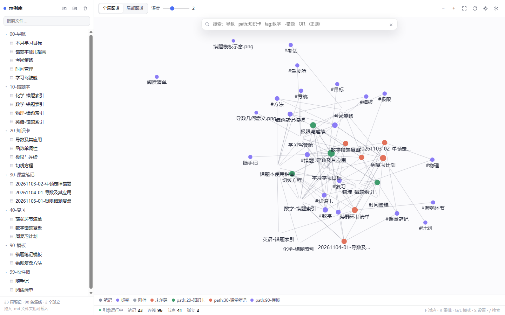
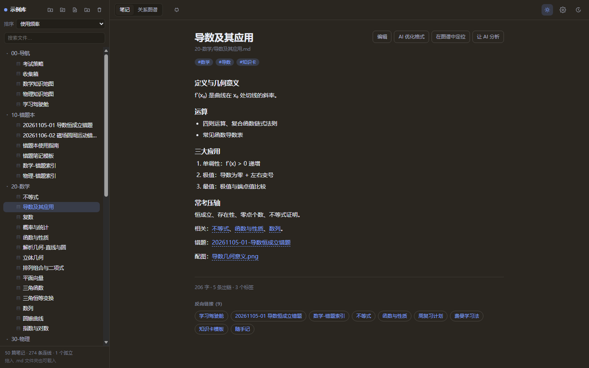

# Race-AiNote · AI 笔记关系图谱

> 2026 第九届传智杯全国大学生数智创新与 AI 应用大赛 · AI 创新应用挑战赛参赛作品
>
> 一句话：**零依赖、单文件、双击即用的知识图谱，能直接读取你真实笔记里的双链与标签。**




---

## 1. 是什么

一个 Obsidian Graph View 的复刻 + 增强：

- **真数据**：读取真实 Markdown 库，解析 `[[双链]]`、`![[嵌入]]`、`#标签`、frontmatter 的 `title/tags/aliases`，生成节点与连线（不是硬编码的假数据）。
- **零依赖**：纯 HTML + CSS + 原生 JavaScript + Canvas 2D，无框架、无构建依赖、无网络请求。
- **单文件交付**：`dist/Race-AiNote.html` 双击就能跑，不上传任何笔记内容，隐私零外泄。
- **配套 AI 整理脚本**：按「只出建议稿、不改原文」的原则批量生成摘要 / 标签 / 双链建议。

---

## 2. 10 分钟极速复现

### 2.1 环境要求

| 项目 | 要求 |
| --- | --- |
| 操作系统 | Windows / macOS / Linux 均可 |
| 浏览器 | Chrome / Edge 90+（推荐，支持直接选文件夹）；Firefox / Safari 可用拖放方式 |
| Node.js | ≥ 20（仅开发、测试、构建和 AI 脚本需要；**只是想看图谱可以完全不装**） |
| 网络 | 只有 AI 整理脚本需要出网；图谱本身全程离线 |

### 2.2 最快路径（0 分钟，不装任何东西）

```
双击 dist/Race-AiNote.html
```

浏览器会加载内置的 23 篇 Markdown 示例库，直接可以拖节点、搜索、切主题。

### 2.3 看自己的笔记（约 1 分钟）

1. 双击 `dist/Race-AiNote.html`；
2. 点左上角 **文件夹图标** → 选中你的 Obsidian 库目录（或任意装着 `.md` 的目录）；
3. 浏览器授权后立即出图。

> 不支持 File System Access API 的浏览器：把整个笔记文件夹**拖进页面**，或点文件夹图标走 `<input webkitdirectory>` 兜底方案。

### 2.4 从源码运行与构建（约 3 分钟）

```bash
git clone https://gitee.com/ressoap/race-ai-note.git
cd Race-AiNote
npm install            # 只装 jsdom 一个开发依赖，用于冒烟测试
npm test               # 29 项单元测试（解析层 / 查询层 / 物理层）
npm run build          # 内联成 dist/Race-AiNote.html
```

打开 `index.html` 也能直接开发调试（浏览器直接加载 `js/*.js`，无打包器）。

### 2.5 跑 AI 整理脚本（约 5 分钟）

```bash
# 1) 先试运行，确认要处理哪些文件，不发请求、不写文件
node scripts/ai-organize.mjs --vault ./vault-example --dry-run

# 2) 设置密钥（只从环境变量读取，不要写进代码或提交仓库）
#    Windows PowerShell
$env:COMMAND_CODE_API_KEY="你的key"
#    Git Bash / macOS / Linux
export COMMAND_CODE_API_KEY=你的key

# 3) 正式运行（建议先小批量验证）
node scripts/ai-organize.mjs --vault ./vault-example --limit 3
```

输出落在 `<库目录>/_ai-建议稿/`，每篇一个建议稿 + 一份运行日志；**原笔记一个字节都不会被改动**。

可选环境变量：

| 变量 | 默认值 | 说明 |
| --- | --- | --- |
| `COMMAND_CODE_API_KEY` | （必填） | OpenAI 兼容接口密钥；也兼容 `AI_API_KEY` |
| `AI_BASE_URL` | `https://api.deepseek.com/v1` | 接口地址，可换成任意兼容服务 |
| `AI_MODEL` | `deepseek-chat` | 模型名 |

---

## 3. 目录结构

```
Race-AiNote/
├─ index.html               开发版页面（外部引用 css/js）
├─ styles.css               明暗双主题样式
├─ js/
│  ├─ vault.js              Markdown 库解析：frontmatter / 双链 / 标签 / 附件
│  ├─ query.js              Obsidian 风格查询语法
│  ├─ physics.js            自定义力导向引擎（哈希初始化、网格碰撞）
│  ├─ render.js             Canvas 2D 渲染层
│  ├─ demo-vault.js         内置示例库（真实 Markdown 文本）
│  └─ app.js                界面装配与交互
├─ scripts/
│  ├─ build.js              内联构建 → dist/Race-AiNote.html
│  └─ ai-organize.mjs       AI 整理脚本（建议稿模式）
├─ tests/                   Node 原生 test runner 单元测试
├─ vault-example/           可直接打开的示例 Markdown 库
├─ dist/Race-AiNote.html    ★ 单文件交付物
├─ docs/                    技术文档与 Prompt 演进记录
├─ PROMPT.md                原始功能规格 Prompt
├─ 可行性分析.md             立项论证
└─ 2026传智杯-…赛道详情.md    赛题原文存档
```

---

## 4. 功能清单

**图谱**
- 全局图谱 / 局部图谱（以选中节点为根，BFS 深度 1–4）
- 自定义力导向：排斥力、连线弹簧力、中心引力、碰撞分离，四个滑杆实时生效
- 节点拖拽（拖拽期间冻结该节点）、画布平移、滚轮以鼠标为中心缩放、双击预览、适应画布、重新布局
- 悬停 / 选中高亮邻居，无关节点与连线自动淡化

**搜索与筛选**
- 语法：普通文本、`path:`、`file:`、`tag:`、`content:`、`-排除`、`OR`、`"带空格"`、`/正则/`
- 筛选开关：标签节点、附件节点、仅现有文件（隐藏未创建链接）、只看孤立节点

**外观**
- 颜色分组（按搜索表达式给节点上色，可增删改）
- 箭头开关、文字淡出阈值、节点大小、连线粗细
- 明暗主题，设置自动保存到 localStorage

**数据**
- 三种载入方式：目录选择器 / `webkitdirectory` 兜底 / 拖放目录递归读取
- 附件、未创建链接（幽灵节点）分别用不同样式与颜色标识
- 左侧按目录分组的文件树，点击定位到节点

---

## 5. 快捷键

| 键 | 作用 |
| --- | --- |
| `/` 或 `Ctrl/Cmd + K` | 聚焦搜索框 |
| `F` | 适应画布 |
| `R` | 重新布局 |
| `G` / `L` | 全局 / 局部图谱 |
| `S` | 打开 / 关闭设置面板 |
| `+` / `-` | 放大 / 缩小 |
| `Esc` | 依次关闭弹窗 / 设置 / 取消选中 / 清空搜索 |

---

## 6. 安全与隐私

- 图谱本身**不发任何网络请求**，笔记内容全程留在本机浏览器内存里。
- AI 脚本的密钥只从环境变量读取，不写入代码、不落盘、不进仓库；`.gitignore` 已排除 `.env*`、`*.pem`、`*.key`、`secrets/`。
- 说明：纯前端项目**不适合**内嵌任何 API Key（打包后明文可见），所以 AI 能力一律放在本地 Node 脚本侧。

---

## 7. 已知限制

- 只做「关系图谱」一件小事，不提供笔记编辑功能（编辑请回 Obsidian）。
- 浏览器不保证文件读取性能，超大库（>5000 篇）建议先用脚本预生成 JSON。
- 未实现正则以外的 Obsidian 高级搜索（`section:`、`line:`、`task:`）。
- 全局排斥力仍是 O(n²)，中大型库建议关闭标签节点以获得更好帧率。

---

## 8. 文档与演进记录

- `docs/PROMPT-LOG.md`：Prompt 链快照（需求 → AI 产出 → 人工纠偏 → 验收）
- `docs/ARCHITECTURE.md`：架构与关键决策说明
- `PROMPT.md`：最初的单条规格 Prompt
- `可行性分析.md`：立项前的可行性论证与 MVP 排序

---

## 9. 仓库托管

| 用途 | 地址 |
| --- | --- |
| 主仓（Gitee，Public） | https://gitee.com/ressoap/race-ai-note |
| 镜像（GitHub，Public） | https://github.com/ressoap/Race-AiNote |

双远程配置、一键推两边的命令与常见坑见 。

---

## 10. 许可证

仅供学习与参赛使用。
