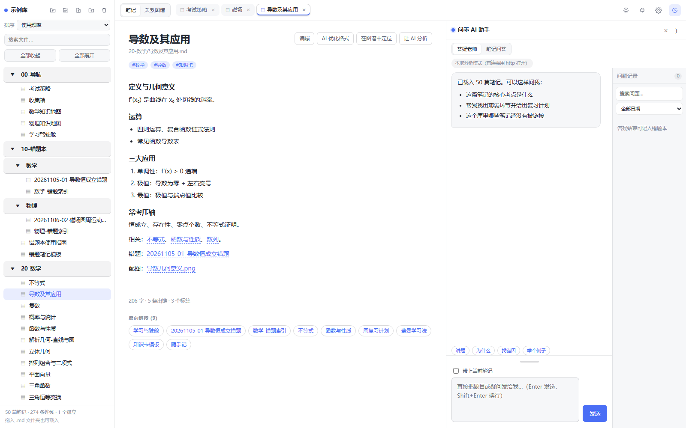
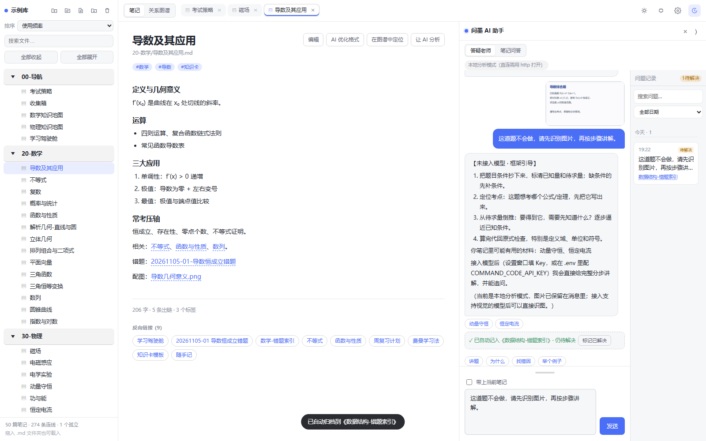
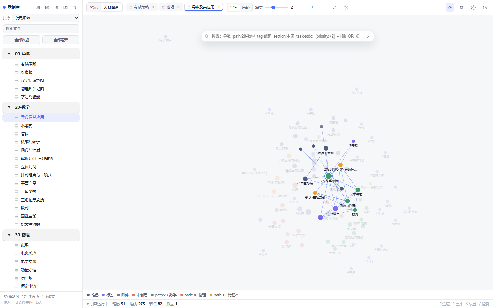
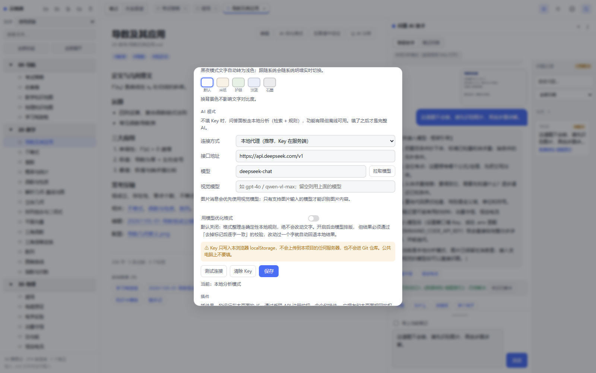

# 问墨笔记 · 作品介绍文档

> **一句话：问墨笔记，是一个会回答问题的本地 AI 笔记工作台。**
>
> 2026 第九届传智杯全国大学生数智创新与 AI 应用大赛 · AI 创新应用挑战赛  
> 文档版本：精简版 v1.0｜2026-11-16

---

## 一、项目详情及使用方式

### 1.1 项目是什么

问墨笔记直接读取本地 Markdown 笔记库，把“阅读笔记、AI 答疑、错题归档、关系图谱”放进同一个工作台。产品主次明确：**笔记是主体，AI 答疑是特色，关系图谱是辅助。**

它解决三个真实问题：

1. AI 聊天里的讲解留不下来，无法沉淀成自己的错题资产；
2. 错题本只保留摘要，原题条件、问法、公式容易丢失；
3. 云端 AI 笔记工具难以判断哪些内容被上传，数据不在自己手里。

### 1.2 核心闭环

```text
本地 Markdown 笔记
      ↓
多标签阅读 / 所见即所得编辑 / 双链与标签
      ↓
文本或图片提问 → 视觉模型识图 → 学科与知识点分析
      ↓
完整原题 + 解析写入 10-错题本/<学科>/
      ↓
去重 / 已解决 / 日期筛选 / 定位原错题段落
```

### 1.3 主要功能

| 模块 | 能力 |
| --- | --- |
| 笔记 | 多级文件树、多标签页、阅读、反向链接、新建立/重命名/删除/拖拽移动 |
| 编辑 | 所见即所得，选中文字可加粗/斜体/下划线/高亮/链接笔记；`Ctrl+S` 保存 |
| AI 问答 | “答疑老师 / 笔记问答”双人设，多轮追问，支持当前笔记与相关笔记上下文 |
| 图片问答 | 图片/截图拖入 AI 面板，最多 3 张、单张 ≤8 MB；可单独配置视觉模型 |
| 错题闭环 | 自动学科分类、完整原题归档、按学科目录存放、去重、已解决、定位高亮 |
| 问题记录 | 最新在上、日期分块、搜索、日期筛选、详情、右键管理、按时间排序 |
| 关系图谱 | 全局/局部图谱、1–4 层深度、力导向、拖拽缩放、邻居高亮、高级查询 |
| 数据与扩展 | 本地存储迁移、插件、GitHub/Gitee/百度网盘官方接口备份 |

### 1.4 使用方式

| 方式 | 入口 | 说明 |
| --- | --- | --- |
| 单文件 HTML | `dist/Wenmo-Notes.html` | 双击即用，离线阅读、编辑、图谱、本地分析 |
| 桌面窗口 | `启动问墨笔记.bat` | 本地服务 + 独立应用窗口，完整 AI 与云端能力 |
| Windows exe | `dist/Wenmo-Notes.exe` | 内置 Node，目标机器无需安装 Node |
| Electron | `dist/Wenmo-Notes-Electron/Wenmo-Notes.exe` | 传统桌面窗口体验 |

**基本流程**

1. 打开应用，选择本地 Markdown 文件夹；
2. 在文件树或标签页中选择笔记，阅读或进入所见即所得编辑；
3. 把题目文字或截图发给“答疑老师”；
4. 回答完成后点击“记入错题本”，系统自动写入对应学科目录；
5. 在问题记录中按日期、关键词检索，必要时定位回原错题段落；
6. 在关系图谱中查看结构、孤立笔记和相关知识。

**模型配置**

默认支持本地分析；配置 Key 后可走本地代理或浏览器直连。文本模型用于普通问答，视觉模型只在消息带图片时使用。推荐把 Key 放在服务端 `.env`，不要把真实凭据写入仓库。

```bash
cp .env.example .env
# COMMAND_CODE_API_KEY=<YOUR_API_KEY>
# AI_MODEL=deepseek-chat
# AI_VISION_MODEL=<YOUR_VISION_MODEL>
node scripts/serve.mjs
```

图片问答支持附件提问；侧栏相机按钮已支持“拍题入库”：视觉模型识别题目原文后，按学科生成题目笔记，多题切分与公式准确率仍需人工校对。

### 1.5 复现

```bash
npm install
npm test        # 100 项自动化测试
npm run build   # 构建单文件 HTML
npm run smoke   # 源码 + 单文件产物冒烟
npm run serve   # 本地服务
```

---

## 二、项目亮点

1. **笔记主体，不是 AI 聊天壳**：文件树、标签页、整页编辑和反向链接构成主视图；AI 与图谱围绕笔记工作。
2. **完整学习闭环**：答疑后自动分析学科与知识点，完整原题和解析一起写入学科错题本，可去重、标记已解决、定位复习。
3. **图片真正接入视觉模型**：图片可随问题发送，带当前笔记时仍优先识图；未配置视觉模型或本地模式会明确提示，不假装识图。
4. **本地 Markdown，数据可控**：直接读取真实 `.md` 文件夹，支持双链、标签、附件和 frontmatter；不锁定云端格式。
5. **零运行时依赖，多端交付**：单文件 HTML、Windows exe、Electron、桌面窗口共用同一套前端与本地服务。
6. **桌面级交互**：浏览器式笔记标签页可拖动排序和恢复；侧栏与 AI 面板可拖宽；文件夹可全部展开/收起。
7. **安全边界清晰**：Key 默认只在服务端内存中；服务仅监听 `127.0.0.1`；静态白名单与 Host/Origin 校验覆盖。
8. **可追溯的 AI 协同开发**：44 次 Git 提交、17 条 Prompt 链，记录需求、AI 产出、失败、修复和验收。

---

## 三、AI 测试技术落地概述

本项目把 AI 测试拆成三层：纯逻辑单测、AI 合同测试、端到端与视觉验收。AI 合同测试使用本地模拟上游，不依赖真实 Key，覆盖文本模型、视觉模型、图片消息、人设、JSON 分析和无 Key 降级。

| 验证项 | 结果 |
| --- | --- |
| 文本/视觉接口 | 图片以 `image_url` 发送，指定 `visionModel` 生效 |
| 双人设与多轮 | 答疑老师与笔记问答历史隔离，多轮消息正确透传 |
| 无 Key 降级 | 健康检查 503，前端自动降级为本地分析 |
| 图片拖放 | 不触发整库载入，缩略图出现且可移除 |
| AI 输出清洗 | LaTeX/`frac`/`sqrt`/项目符号可读，代码块不被误清洗 |
| 原题完整性 | 500 字以上、多行、多问原题不截断、不压平，可正确去重 |
| 学科边界 | 英语、数据结构、信号系统不串科；泛问可由答案兜底 |
| UI 状态 | 标签页开关/排序/持久化、侧栏和 AI 面板拖宽、双击复位 |
| 安全边界 | `.env`、`.git`、`data/` 静态访问 404；跨站 Origin 403 |

**本次复验结果（2026-11-16）**

- `npm test`：100 项通过，0 失败；
- `npm run smoke`：退出码 0，`errors=[]`；
- 示例库：50 篇笔记、3 个附件、27 个标签、274 条链接；
- 图谱装配：80 个节点、273 条可见连线；
- 单文件构建：外部脚本 0 个、内联样式 1 份，无运行时错误；
- 视觉接口合同测试：带图片时上游收到 1 个 `image_url`，模型名为 `mock-vision`。

**如实说明**：真实模型的答案正确率、引用准确率、幻觉率、视觉识图准确率和 Token 成本尚无系统基准；拍题入库已是“视觉模型识别 + 人工校对”的半自动流程，未宣称全自动 OCR。后续应补真实模型黄金题集、图片题测试集和大图性能基准。

---

## 四、关键技术

| 技术 | 实现要点 |
| --- | --- |
| Markdown 解析 | frontmatter、双链、别名、嵌入、标签、附件、未创建链接与最短路径解析 |
| 查询 DSL | `path:`、`tag:`、`content:`、`task:`、属性比较、排除、`OR`、正则 |
| 力导向图 | 哈希初始化、排斥/弹簧/中心力、网格碰撞、Canvas 2D、确定性布局 |
| 所见即所得 | HTML ⇄ Markdown 往返、选区工具条、笔记链接、AI 格式整理不改正文 |
| AI 代理 | 服务端 Key、文本/视觉模型分离、多人设 Prompt、结构化学科分析 |
| 图片流水线 | 图片筛选、8 MB 上限、最长边 1280 缩放、缩略图、`image_url` 内容块 |
| 错题归档 | 模型+规则学科分类、完整原题引用块、学科目录迁移、按完整原题去重 |
| 本地状态 | schema v2、旧键迁移、标签页与面板宽度持久化、问题记录双端合并 |
| 安全与交付 | `127.0.0.1`、静态白名单、Host/Origin 校验、单文件构建、SEA、Electron、图标资源 |

---

## 五、项目图片



**图 1**：笔记主视图。顶部是打开过的笔记标签页，中间为阅读/编辑区，右侧为 AI 助手。



**图 2**：图片问答。图片会作为消息附件保留；没有真实视觉模型时明确提示本地模式不会识图。



**图 3**：关系图谱。双链自动生成节点和连线，支持查询、筛选、拖拽、缩放与邻居高亮。



**图 4**：设置窗口。可分别配置文本模型和视觉模型，并选择本地代理、浏览器直连或纯本地分析。

---

## 六、发表或获奖情况

截至 2026-11-16，明确结论如下：

- **本项目从未公开发表过论文、文章或作品**；
- **本项目没有获得过任何奖项，不是获奖作品**；
- 项目材料中暂无专利、软件著作权等证明；
- 本项目仅为 2026 传智杯 AI 创新应用挑战赛参赛作品，处于省赛提交材料完善阶段，尚未评审、未获任何奖项。

正式表述：**未公开发表、未获得任何奖项，仅报名参赛。** 本版不填写任何奖项等级、获奖时间或证书编号，也不写“已发表”。若未来确实取得论文、软著、专利或赛事奖项，必须凭真实证明再更新，不能把“参赛”写成“获奖”。

---

## 七、在其他项目基础上的优化说明

问墨笔记是原创项目，不是基于现成开源项目二次包装。项目最初源于“复刻关系图谱”的单功能原型，随后依据实际学习场景完成了产品重心调整：

| 阶段 | 优化 |
| --- | --- |
| 产品定位 | 从图谱展示器转为“笔记主体 + AI 答疑 + 图谱辅助” |
| AI 能力 | 从单一问答扩展为双人设、多轮、三种连接方式、本地降级 |
| 学习闭环 | 增加学科分类、错题归档、去重、已解决、问题记录与定位 |
| 编辑体验 | 增加所见即所得编辑、选区工具条、AI 格式整理与快捷键保存 |
| 图片问答 | 修复图片拖放被全局监听劫持，增加视觉模型与图片消息 |
| 错题完整性 | 原题全文归档、学科文件夹、旧版平铺文件迁移 |
| 桌面交互 | 增加笔记标签页、侧栏/AI 面板拖宽、全部展开/收起 |
| 工程交付 | 增加单文件 HTML、SEA exe、Electron、统一图标与 100 项测试 |

上述迭代记录在 `docs/PROMPT-LOG.md` 的 17 条 Prompt 链中，代码、测试和构建链均可复现。

---

## 八、结论

问墨笔记把本地 Markdown 笔记、AI 文本/图片答疑、完整错题归档和关系图谱组合成一条可走通的学习链路：

- 对用户：笔记仍然是自己的，答疑能沉淀，原题不会丢；
- 对评审：有真实数据、完整交互、清晰架构、可复现测试与连续迭代记录；
- 对工程：零运行时依赖、多端交付、服务端密钥边界、视觉模型分离和自动降级均已落地。

项目不虚构奖项或模型准确率，也不把半自动拍题写成全自动 OCR。提交前应优先补真实视觉模型评测、拍题入库流程、演示视频和公开仓库链接。
