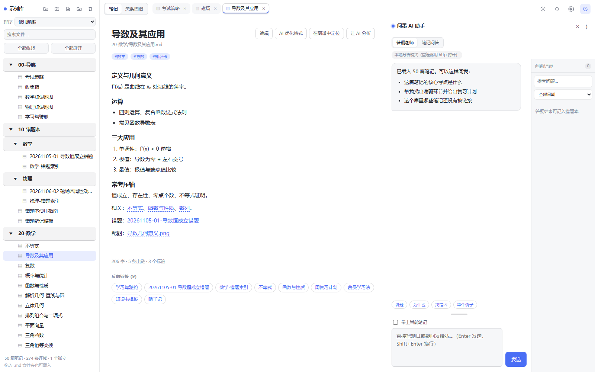
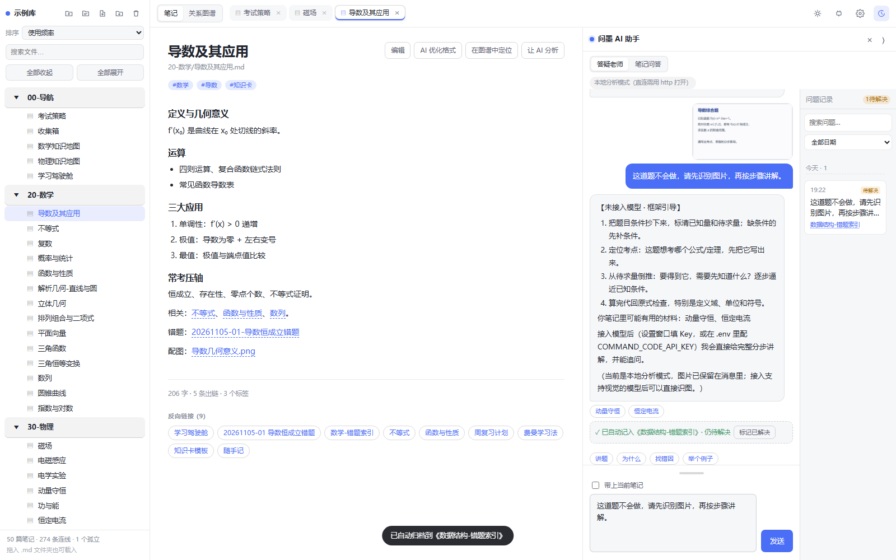
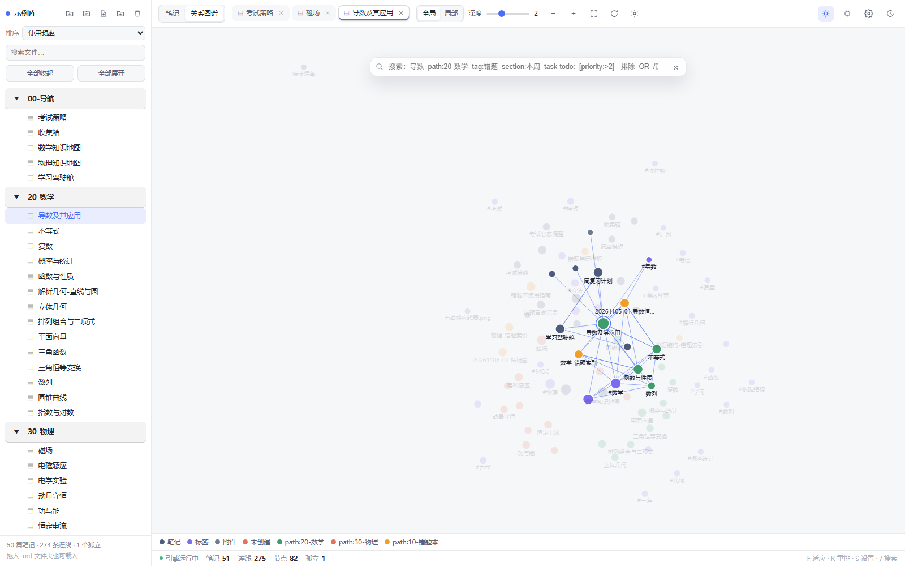
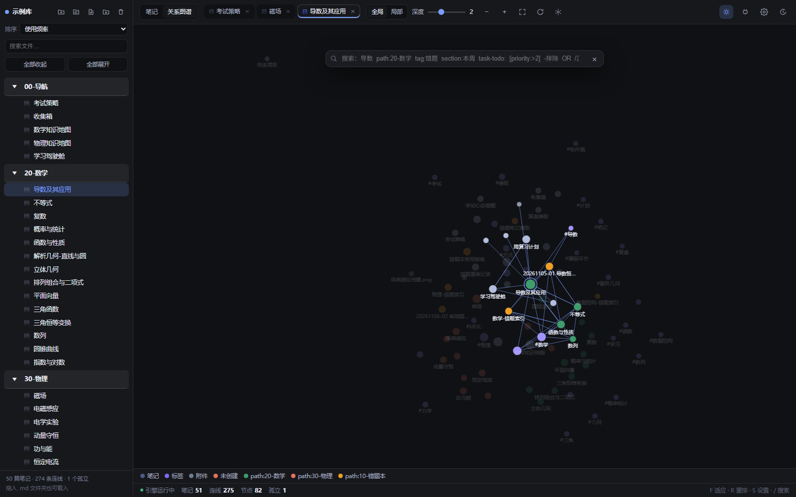
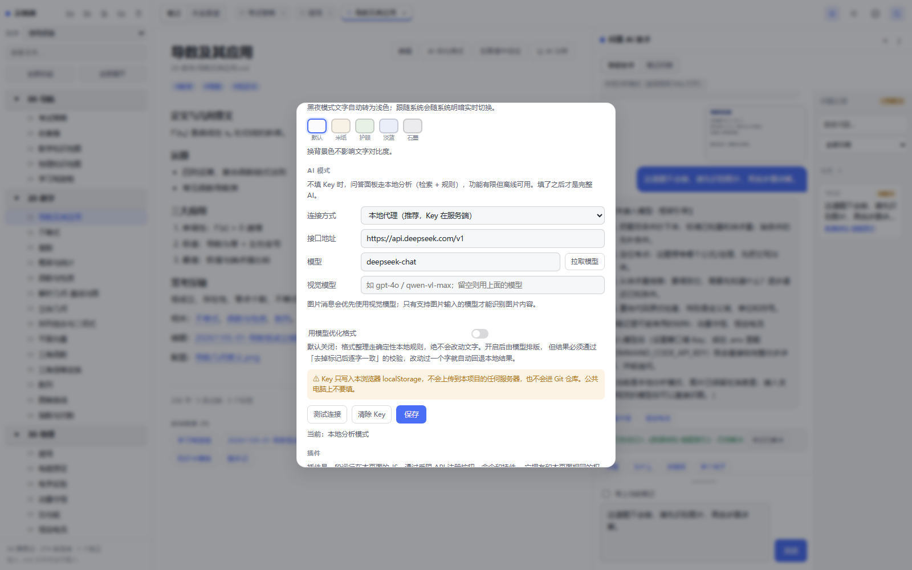

# 问墨笔记 · 作品介绍文档

> **一句话定位：问墨笔记，是一个以 AI 答疑为特色的本地 Markdown 笔记工作台。**
>
> 参赛赛事：2026 第九届传智杯全国大学生数智创新与 AI 应用大赛 · AI 创新应用挑战赛  
> 文档版本：v1.2（2026-11-17 项目补强版）  
> 编写日期：2026-11-16  
> 项目版本：0.1.0；当前 Git 历史连续提交，自动化测试 100 项  
> 配套材料：产品图标、5 张界面截图、可复现构建链与 Prompt 链快照

---

## 作品速览

| 项目 | 内容 |
| --- | --- |
| 作品名称 | 问墨笔记（Wenmo Notes） |
| 产品类型 | 本地优先的 AI 笔记工作台 / Markdown 知识库应用 |
| 核心用户 | 有 Markdown 笔记习惯的学生、备考者、自学者和知识管理用户 |
| 产品主线 | 笔记是主体，AI 答疑是特色，关系图谱是辅助视图 |
| 技术底座 | HTML + CSS + 原生 JavaScript + Canvas 2D；Node.js 本地服务；无第三方运行时依赖 |
| AI 接入 | 本地代理 / 浏览器直连 / 纯本地分析三种模式；支持文本模型与视觉模型 |
| 新增交互 | 图片/截图问答、拍题入库、老师性格、浏览器式标签页、可调布局、图谱右键菜单、文件夹全展开/全收起 |
| 错题闭环 | 完整保留原题目；按学科文件夹归档；去重、已解决、日期筛选与定位高亮 |
| 交付形态 | 单文件 HTML、Windows 单文件 exe、Electron 桌面版、浏览器本地服务 |
| 数据格式 | 标准 Markdown 文件夹，支持 `[[双链]]`、`![[嵌入]]`、`#标签`、frontmatter |
| 当前阶段 | 2026 传智杯 AI 创新应用挑战赛省赛提交材料完善阶段 |

### 本次更新摘要（2026-11-16）

| 更新项 | 落地结果 |
| --- | --- |
| 图片/截图问答 | AI 面板可直接拖入图片，最多 3 张、单张不超过 8 MB；浏览器端按最长边 1280 缩放后发送 |
| 视觉模型 | 设置窗口新增“视觉模型”字段；`.env` 支持 `AI_VISION_MODEL`；带图片时优先调用视觉模型 |
| 浏览器式标签页 | 打开过的笔记保留为标签，可切换、关闭、中键关闭、拖动排序，状态可恢复 |
| 桌面式布局 | 左侧栏可在 190–520 px 拖动调宽；AI 面板可拖动调宽；双击恢复默认值并记住 |
| 错题数据完整性 | 错题归档保留原题全文，不再截断或压平；去重按完整原题比对 |
| 学科目录 | 所有学科按需建立 `10-错题本/<学科>/` 文件夹；旧版平铺错题本启动时自动迁移 |
| AI 输出可读性 | 清洗 LaTeX 定界符与 `frac/sqrt`，把项目符号转成 Markdown 列表，代码块保持原样 |
| 界面细节 | 文件夹全部展开/收起、问题记录最新在上、插件命令移至工具栏右侧 |
| 拍题入库 | 侧栏相机入口调用视觉模型，只识别题目原文，自动按学科建到 `10-错题本/<学科>/`，保留原题引用块与知识点 |
| 老师性格 | 设置按钮左侧独立入口，可载入 `.md` 讲课约束，四根滑杆编译进答疑老师系统提示词 |
| 图谱右键 | 新标签页/新窗口、移动、收藏、合并、复制路径、反向链接、图谱定位、导出、删除 |
| 问答中断 | 请求中显示停止按钮，支持 abort 当前请求并跳过本轮自动归档 |
| 磁盘回写 | 打开本地文件夹并授权读写后，编辑、新建、改名、删除自动回写真实 Markdown |
| 大图性能 | >360 节点自动切到 3×3 网格 + 远端质心近似，500 节点稳定性有单测 |
| 无控制台启动 | SEA exe 改为 Windows GUI 子系统，启动不再弹黑色控制台，启动日志写入 `data/startup.log` |
| 品牌图标 | 统一 favicon、网页图标、Electron 窗口图标、桌面快捷方式与 exe 资源图标 |
| 测试 | 自动化测试扩充到 **100 项全部通过**；冒烟测试覆盖标签、拖拽、图片、拍题入口、磁盘回写、图谱菜单、老师性格与问答中断 |

### 目录

1. 项目详情及使用方式
2. 项目亮点
3. AI 测试技术落地使用情况概述
4. 项目涉及的关键技术
5. 项目相关图片 / 照片
6. 发表或获奖情况
7. 在其他项目基础上的优化说明
8. 当前局限与后续计划
9. 结论与复现证据

---

## 一、项目详情及使用方式

### 1.1 项目背景与问题定义

学生在日常学习中通常同时使用三类工具：Markdown 笔记软件、AI 聊天工具和错题本。三者彼此割裂，带来五个真实问题：

1. **问答留不下来**：在 AI 聊天窗口里讲懂的题，过几天找不到；复制回笔记又要重复整理。
2. **错题无法沉淀**：题目、答案、学科和知识点分散在不同文件里，难以形成可检索的复习资产。
3. **复习时会丢原题**：很多错题工具只保留“知识点摘要”，过几天只剩一句结论，题目条件、问法和公式都没了。
4. **知识图谱只是“好看”**：传统图谱偏向展示，不能直接支撑“提问—理解—归档—复习”的学习闭环。
5. **隐私与数据主权**：把整库笔记上传到云端 AI 服务，用户难以判断哪些内容被发送、发送给了谁。

问墨笔记的目标不是再做一个通用聊天框，而是把 AI 放进已经存在的 Markdown 笔记工作流中：**读自己的笔记、问自己的问题、把有价值的答疑完整沉淀为自己的错题本。** 2026-11-16 的更新进一步补齐了图片问答、浏览器式标签页、可调布局和原题保留等真实使用细节。

### 1.2 产品定位与目标场景

问墨笔记是一个可以直接读写本地 Markdown 笔记库的工作台。它坚持三个产品原则：

- **笔记是主体**：左侧多级文件树、中间整页阅读与所见即所得编辑、顶部笔记标签页，笔记的增删改查是产品地基。
- **AI 答疑是特色**：右侧常驻“答疑老师 / 笔记问答”双人设面板，回答可以引用笔记并反哺笔记库。
- **图谱是辅助**：关系图谱用于理解结构、发现孤立笔记、定位相关知识，不喧宾夺主。

典型使用场景：

| 场景 | 使用流程 |
| --- | --- |
| 课后整理 | 打开课程笔记库 → 在笔记中标记疑问 → 拍照/拖图给答疑老师 → 一键记入对应学科错题本 |
| 考前复习 | 搜索错题本 → 按学科、知识点、日期筛选问题记录 → 定位到具体错题段落，回看原题全文 |
| 知识梳理 | 查看反向链接与关系图谱 → 发现孤立笔记 → 补充双链和标签 |
| 多笔记对照 | 用浏览器式标签页在导数、磁场、错题索引之间快速切换，拖动调整标签顺序 |
| 跨设备备份 | 通过 GitHub / Gitee / 百度网盘官方接口备份整库快照 |
| 个性化扩展 | 安装或编写插件，注册命令、工具栏按钮、笔记挂件和事件回调 |

### 1.3 核心功能闭环

产品的主流程可以概括为：

```text
载入 Markdown 库
      ↓
多标签阅读 / 所见即所得编辑 / 双链与标签解析
      ↓
向「答疑老师」提问（可带当前笔记、相关笔记片段和图片）
      ↓
获得分步讲解 → 视觉模型识图 → 自动识别学科与知识点
      ↓
完整原题目 + 解析写入 10-错题本/<学科>/ → 去重、状态标记、问题记录
      ↓
通过搜索、日期筛选、反向链接、关系图谱回到原笔记复习
```

主要功能模块如下：

| 模块 | 已实现能力 |
| --- | --- |
| 笔记库 | 打开本地文件夹、拖放导入、多级目录、新建/重命名/删除/移动、全部展开/收起、使用频率/更新时间/名称/手动排序 |
| 阅读与编辑 | Markdown 渲染、反向链接、标签、任务列表、代码块、双链跳转；所见即所得编辑；选中文字工具条；`Ctrl/Cmd + S` 保存 |
| 笔记标签页 | 最多保留 24 个打开标签；点击切换、× 或中键关闭、拖动排序、左右方向键切换、状态持久化 |
| 布局 | 左侧栏 190–520 px 可调宽，默认 268 px；AI 面板可调宽，默认 560 px；双击恢复默认并记住 |
| AI 问答 | 答疑老师、笔记问答双人设；多轮追问；当前笔记与关键词检索上下文；无模型时本地规则兜底 |
| 图片问答 | 拖入图片生成缩略图随问题发送；最多 3 张、单张 ≤8 MB；可配合当前笔记发送；视觉模型可单独配置 |
| 错题闭环 | 自动分析学科与知识点；原题全文写入 `### 原题目` 引用块；写入对应学科目录；去重；已解决状态；问答归档 |
| 问题记录 | 最新记录排最上；今天/昨天/具体日期分块；搜索；日期下拉；左键详情；右键归档/继续询问/删除；记录只按时间排序，不支持拖动改顺序 |
| 关系图谱 | 全局/局部图谱、1–4 层深度、力导向布局、节点拖拽、画布平移缩放、邻居高亮、标签、附件、孤立节点筛选 |
| 查询语法 | 普通文本、`path:`、`file:`、`tag:`、`content:`、`section:`、`line:`、`block:`、`task:`、属性比较、`-排除`、`OR`、正则 |
| 数据与安全 | 本地存储 schema 迁移；本地服务仅监听 `127.0.0.1`；静态白名单；Host/Origin 校验；API Key 默认放服务端 |
| 扩展与备份 | 插件安装/启停/卸载；GitHub、Gitee、百度网盘官方接口备份与恢复 |
| 外观与图标 | 白日/黑夜/跟随系统；五套背景色；黑夜模式浅色文字；统一 favicon、窗口图标和 exe 图标 |

### 1.4 系统结构

```text
┌──────────────────────────────────────────────────────────┐
│                     浏览器 / 桌面窗口                     │
│ 文件树 │ 笔记标签页 │ 笔记阅读与编辑 │ AI 面板 │ 图谱 │ 设置 │
└──────────┬───────────────────────────────┬───────────────┘
           │ 纯前端数据层                   │ AI / 云盘 / 记录 API
           ▼                               ▼
┌───────────────────────────┐  ┌────────────────────────────┐
│ vault / query             │  │ Node 本地服务               │
│ markdown / richtext       │  │ server-core.cjs             │
│ physics / render          │  │ /api/chat  /api/analyze     │
│ store / noteTabs          │  │ /api/models /api/health     │
│ sidebar / AI 面板尺寸     │  │ /api/records /api/cloud/*   │
└───────────────────────────┘  └──────────────┬─────────────┘
                                              │
                              ┌───────────────▼─────────────┐
                              │ OpenAI 兼容文本模型          │
                              │ 可选视觉模型（图片消息）     │
                              │ GitHub / Gitee / 百度网盘    │
                              │ data/records.json            │
                              └─────────────────────────────┘
```

前端数据层保持纯函数、无 DOM 依赖，物理引擎和 Canvas 渲染层均可在 Node 中单独测试；本地服务是 AI、云盘和记录持久化的唯一出入口，`serve.mjs`、Node SEA 单文件 exe、Electron 三种启动方式共用同一份 `server-core.cjs`。

### 1.5 使用方式

#### A. 最快体验：单文件 HTML

适合评委快速查看、离线演示和零安装试用。

1. 双击 `dist/Wenmo-Notes.html`；
2. 浏览器加载内置 50 篇示例笔记，直接浏览笔记、使用多标签、查询图谱、进行本地分析问答；
3. 点击左上角文件夹图标选择自己的 Markdown 文件夹，或把整个笔记文件夹拖进页面。

单文件版不需要 Node、不需要安装依赖、不需要联网。阅读、编辑、标签页、图谱与本地规则问答全程离线；只有主动配置并调用模型时才会出网。

#### B. 完整能力：本地服务 + 桌面窗口

需要 AI 模型、图片识别、问题记录文件持久化、云盘备份和插件完整能力时，使用带本地服务的方式：

```text
双击：启动问墨笔记.bat
```

该脚本会启动本地服务，并用 Edge / Chrome 的应用模式打开独立窗口。也可以手动执行：

```bash
npm install
node scripts/serve.mjs
# 浏览器打开 http://127.0.0.1:4321
```

其他启动形态：

| 方式 | 入口 | 适用场景 |
| --- | --- | --- |
| 浏览器 + 本地服务 | `npm run serve` | 开发调试、完整 AI、图片与云端能力 |
| 桌面应用窗口 | `启动问墨笔记.bat` / `npm run desktop` | 日常使用，无地址栏、独立窗口 |
| Windows 单文件 exe | `dist/Wenmo-Notes.exe` | 分发给没有 Node 环境的用户 |
| Electron 桌面版 | `dist/Wenmo-Notes-Electron/Wenmo-Notes.exe` | 接近传统桌面软件的安装/启动体验 |

#### C. 配置文本模型与视觉模型

问墨笔记支持三种连接方式，默认优先使用“本地代理”：

| 模式 | Key 所在位置 | 特点 |
| --- | --- | --- |
| 本地代理 | 服务端 `.env` 或环境变量 | 推荐；前端不接触 Key，可完整使用文本与视觉模型 |
| 浏览器直连 | 当前浏览器 `localStorage` | 可选降级；受服务商 CORS 限制，不建议共享电脑使用 |
| 纯本地分析 | 不需要 Key | 完全离线；孤立笔记、薄弱环节、知识卡、全库检索等规则分析仍可用 |

本地代理的最小配置：

```bash
cp .env.example .env
# 编辑 .env，填入自己的 Key 和可选视觉模型，例如：
# COMMAND_CODE_API_KEY=<YOUR_API_KEY>
# AI_MODEL=deepseek-chat
# AI_VISION_MODEL=<YOUR_VISION_MODEL>
node scripts/serve.mjs
```

在设置窗口（顶部齿轮或按 `P`）可以分别填写“模型”和“视觉模型”。视觉模型只在消息带图片时使用；留空时会沿用文本模型，但普通文本模型通常无法识别图片。

#### D. 图片/截图提问

1. 把题目截图、拍照图片或示意图直接拖入右侧 AI 面板；
2. 输入框上方出现缩略图，可移除；最多 3 张，单张不超过 8 MB；
3. 需要时勾选“带上当前笔记”；图片仍会优先发送给视觉模型，笔记作为辅助上下文；
4. 输入问题并发送，回答中可显示图片缩略图、步骤和笔记引用；
5. 若使用纯本地分析，图片会保留在消息中，但本地规则不会真正识图，界面会明确提示接入视觉模型。

图片还支持“拍题入库”：点侧栏相机按钮选择一张题目图片，视觉模型只识别题目原文，系统按学科自动生成 `10-错题本/<学科>/` 下的题目笔记，保留原题引用块、学科和知识点，之后可继续向 AI 追问。多题切分、公式转写准确率仍需人工抽检。

#### E. 答疑与错题归档

1. 在文件树或标签页中选择一篇笔记，点击“让 AI 分析”或直接在右侧提问；
2. 选择“答疑老师”模式，输入题目或疑问；需要时附加图片；
3. AI 按“考点定位 → 解题思路 → 分步推导 → 易错提醒 → 一句话拓展”回答，条件不足时会先追问；
4. 回答完成后，在操作条中确认学科并点击“记入错题本”；
5. 系统自动把完整原题和解析写入 `10-错题本/<学科>/` 下对应索引，标题形如“知识点 · 日期”；
6. 后续可在问题记录中按日期或关键词检索，点击“定位错题笔记”回到具体段落。

同一道题按完整原题内容去重，重复提问会提示“已记入/已解决”，不会重复往笔记里写。旧版平铺的 `10-错题本/*.md` 会在启动时迁移到学科子目录，并同步记录中的目标路径。

#### F. 多标签与可调布局

- 打开过的笔记会出现在顶部标签条，最多保留 24 个；
- 点击标签切换；点 × 或鼠标中键关闭；关闭当前标签后优先切到右侧相邻标签；
- 标签可直接拖动调整顺序，状态持久化，重启后自动恢复；
- 左侧栏分割线支持拖动调宽，双击恢复 268 px；聚焦后可用方向键微调和 `Home` 恢复默认；
- AI 面板左侧分割线也支持拖动和双击恢复，宽度会保存；
- 文件夹区域提供“全部收起 / 全部展开”，多级目录较多时可快速整理视野。

#### G. 图谱与查询

切换到“关系图谱”后，可以：

- 在“全局 / 局部”之间切换，局部图谱以选中节点为根，支持 1–4 层 BFS；
- 调整排斥力、连线力、中心力、连线距离、节点大小和文字淡出阈值；
- 拖动节点、平移画布、滚轮以鼠标位置为中心缩放；
- 使用查询语法进行筛选，例如：

```text
导数
path:20-数学
tag:错题
content:洛伦兹力
section:本周
task-todo:
[priority:>2]
-已掌握 OR /导数|微分/i
```

#### H. 从源码复现

```bash
git clone <仓库地址>
cd Wenmo-Notes
npm install
npm test            # 100 项自动化测试
npm run build       # 构建单文件 dist/Wenmo-Notes.html
npm run smoke       # 源码 + 构建产物冒烟测试
npm run serve       # 本地服务，默认 4321
```

按需构建桌面产物：

```bash
npm run build:exe       # Windows 单文件 exe（Node SEA）
npm run build:electron  # Electron 桌面版
```

README 提供了 10 分钟复现指南；源码、构建链、测试、Prompt 链和架构说明均在仓库内可查。

#### I. 数据与隐私边界

- 未配置 Key 时，应用不会发送模型请求，笔记留在本机；纯本地分析可用；
- 使用本地代理时，Key 只在 Node 服务端内存中读取，前端只调用同源 `/api/chat`；
- 本地服务默认只监听 `127.0.0.1`，静态资源采用白名单，`.env`、`.git`、`data/`、`_tmp/`、`node_modules/` 不能通过 HTTP 读取；
- 只有用户主动附加图片时，图片才会随问题发给模型；截图和照片可能包含姓名、学号、学校等信息，公开演示前应打码；
- 问题记录同时保存在浏览器 `localStorage` 和本地 `data/records.json`，换端口或换浏览器后可合并恢复。

---

## 二、项目亮点

### 亮点 1：真正的“笔记主体”，不是 AI 聊天壳

很多 AI 笔记产品把聊天框放在中心，笔记变成回答的附件。问墨笔记在重构阶段专门纠正了主次关系：**左侧文件树、中间整页笔记、顶部标签页、底部反向链接是主视图，AI 是右侧常驻助手，关系图谱是辅助视图。** AI 回答通过 `[[笔记标题]]` 回链到已有笔记，答疑结果再沉淀为错题笔记，形成正向循环。

### 亮点 2：“答疑—识图—归因—归档—复习”完整学习闭环

项目不是停留在“回答一个问题”，而是继续完成：

```text
提问 / 图片 → 分步讲解 → 学科与知识点识别 → 完整原题 + 解析写入学科错题本
           → 去重 / 已解决 → 问题记录时间线 → 搜索 / 日期筛选 → 定位原错题段落
```

学科识别支持数学、物理、化学、生物、英语、语文、数据结构、信号与系统等；无模型时使用本地规则兜底，避免 API 不可用时整条链路中断。

### 亮点 3：图片问答真正接入视觉模型

- 图片/截图直接拖入 AI 面板，不触发整库载入，也不会被全局拖放监听劫持；
- 支持最多 3 张图片、单张 8 MB，浏览器端自动缩放，减少 Token 成本和带宽；
- 消息带图片时优先使用设置中的“视觉模型”，普通文本模型只作为无图时的默认模型；
- 可以同时带当前笔记；系统提示明确要求优先识图，笔记只作辅助；
- 未配置视觉模型或使用纯本地分析时，会保留图片并给出明确提示，不假装“已经看懂”。

### 亮点 4：AI 不可用也能用，降级路径真实可测

- **本地代理模式**：Key 不进入前端，适合日常使用；
- **浏览器直连模式**：在服务商允许 CORS 时可用，作为可选方案；
- **纯本地分析模式**：没有 Key、没有网络也能做孤立笔记识别、薄弱环节分析、知识卡整理和全文检索；
- 模型接口不可用时自动降级，页面不白屏，问题记录和笔记功能不受影响。

### 亮点 5：读取真实 Markdown，而不是硬编码演示数据

项目直接解析本地 Markdown 文件夹，支持 frontmatter 的 `title/tags/aliases`。它能识别：

- `[[目标]]`、`[[目标|别名]]`、`[[目标#标题]]`、`![[嵌入]]`；
- 正文 `#标签`、嵌套标签；
- 未创建链接与附件节点；
- 代码块和行内代码中的双链不计入关系；
- 最短路径匹配与同名文件解析。

内置示例库包含 **50 篇笔记、3 个附件、27 个标签、274 条链接**，不是几张写死的卡片。

### 亮点 6：浏览器式标签页与桌面式可调布局

项目把浏览器的高频交互迁移到笔记软件中：

- 多标签保留打开历史，切换、关闭、中键关闭、拖动排序、键盘切换齐全；
- 标签顺序和当前标签可恢复，重启后继续上次工作；
- 左侧栏可拖动调宽，记忆宽度，窗口变窄时自动收缩；
- AI 面板可拖动调宽，阅读长解析时可以给 AI 留更多空间；
- 文件夹可一键全部展开/收起，笔记多时仍然能快速定位。

这些细节让产品更像真实工作台，而不是一次性演示页面。

### 亮点 7：完整保留原题目，错题本不是“摘要桶”

错题归档会写入 `### 原题目` 区块，按 Markdown 引用块保留多行、空行、多问和公式原貌；解析单独放在「解析」区块。去重也改为按完整原题比对，不会因为开头相同就把新题误判为旧题。对于复习而言，**题目条件和问法本身就是最重要的复习材料**。

### 亮点 8：零运行时依赖，交付形态完整

前端只使用 HTML、CSS、原生 JavaScript 和 Canvas 2D，不引入 React/Vue、D3 或第三方图谱库。最终可以交付：

- 一个约 396 KB 的单文件 HTML，双击即运行；
- 一个约 90 MB 的 Windows 单文件 exe，目标机器不需要 Node；
- 一个约 269 MB 的 Electron 桌面版，提供传统桌面窗口体验；
- 本地服务版本，解锁 AI、视觉模型、云同步和文件记录持久化。

同一份前端源码、同一份服务端核心和同一套测试覆盖四种运行形态，降低了演示与评审的复现成本。

### 亮点 9：密钥服务端化与本地安全边界

项目把“Key 不能进前端”当作架构约束：

- 默认从环境变量 / `.env` 读取文本模型和视觉模型 Key，只在 Node 内存中使用；
- 本地服务默认绑定 `127.0.0.1`；
- 静态资源白名单只开放页面、样式和 `js/**`；
- API 校验 Host、Origin 和 `Content-Type: application/json`；
- 页面设置 CSP、`X-Content-Type-Options: nosniff`、`Referrer-Policy: no-referrer`；
- 安全测试覆盖跨站 Origin、非 JSON POST、`.env` / `.git` / `data` 路径访问。

### 亮点 10：确定性力导向图与可复现的演示

自研力导向引擎把排斥力、弹簧力、中心引力、阻尼、边界和网格碰撞组织为可测试的纯数据流程。节点初始位置使用 FNV-1a 哈希推导，初始化不使用随机数，因此“重新布局”、截图和录像可复现。对重合节点、拖拽冻结节点、NaN、空数据和边界都有专门防护；局部图谱使用 BFS 深度控制，避免大图一次性铺满。

### 亮点 11：AI 协同开发过程可追溯

仓库当前保留 44 次细粒度提交，`docs/PROMPT-LOG.md` 已记录 17 条 Prompt 链（链路 0–16），覆盖立项、解析、查询、力导向、UI、AI 人设、错题闭环、所见即所得编辑、云同步、插件、安全重构、图片拖放修复、图标、视觉模型、AI 输出清洗、笔记标签页、侧栏拖宽和原题保留。每条链路都记录了需求、AI 产出、人工纠偏、失败案例和验收标准。

### 亮点 12：测试不是装饰，而是产品能力的一部分

项目采用 Node 原生测试、jsdom、模拟上游模型服务和构建产物冒烟测试，覆盖解析、查询、物理、Markdown、富文本、插件、云盘、存储迁移、服务端安全、AI 降级、视觉模型、标签页、面板拖宽、错题归档与快捷键等关键链路。具体结果见下一节。

---

## 三、AI 测试技术落地使用情况概述

> 说明：本节将“AI 测试技术落地”拆成两层——第一层是 **AI 功能本身如何被测试**，第二层是 **AI 协同开发中的测试生成、失败回放与回归如何落地**。项目当前没有把未经验证的模型能力包装成“已通过 AI 测试”，所有结论都对应可复现的测试或明确的人工验收。

### 3.1 测试策略：三层结构

| 层级 | 目标 | 做法 |
| --- | --- | --- |
| 第 1 层：纯逻辑单测 | 保证数据、解析、查询、物理、存储稳定 | Node 原生 `node:test`；输入输出断言；边界值和异常路径 |
| 第 2 层：AI 合同测试 | 保证前端、代理、文本/视觉模型接口、人设和结构输出不漂移 | 本地模拟 OpenAI 兼容上游；断言 system prompt、消息数、图片内容块、视觉模型名、JSON 输出、无 Key 降级 |
| 第 3 层：端到端与视觉验收 | 保证用户主流程真的走得通 | jsdom 冒烟测试 + 真实浏览器截图 + 单文件产物加载验收 |

### 3.2 AI 测试落地矩阵

| 测试对象 | 测试方法 | 已落地结果 |
| --- | --- | --- |
| 代理健康检查 | 启动 `serve.mjs`，请求 `/api/health` | 有 Key 返回 200 与模型名；无 Key 返回 503，前端据此降级 |
| 模型列表 | 模拟 `/v1/models` 上游，调用 `/api/models` | 正确解析并返回候选模型列表 |
| 文本对话转发 | 模拟 `/v1/chat/completions`，验证 Authorization 与 payload | 模型名、消息、人设、上下文均正确透传 |
| 图片对话转发 | 在 `/api/chat` 中发送 1 张图片，模拟视觉上游 | 上游收到 `image_url` 内容块，并使用指定的 `visionModel` |
| 双人设隔离 | 分别以 `notes` / `tutor` 发起请求 | 老师人设返回 tutor system prompt；两侧会话历史互不串台 |
| 多轮上下文 | 传入两条历史消息后再提问 | 上游收到 3 条对话消息，符合最近对话上下文约束 |
| 结构化学科分析 | 模拟 `/api/analyze` 返回 JSON | 解析英语学科与知识点数组；非法/缺失 JSON 时可本地兜底 |
| 无模型降级 | 不配置 Key，直接在单文件版提问 | 答疑老师返回“框架引导”；孤立笔记、知识卡、全库检索仍可用 |
| 图片拖放隔离 | jsdom 模拟图片 drop 到 AI 面板 | `state.files` 不变化，缩略图出现且可移除，不触发整库载入 |
| 视觉模型配置 | 设置窗口写入 `visionModel` 后读取配置 | 配置持久化，带图片时选择视觉模型；无视觉模型时给出提示 |
| AI 输出清洗 | 输入 LaTeX 定界符、`frac`、`sqrt`、`•`、单星号列表 | 输出可读文本和 Markdown 列表；代码块内反斜杠保持原样 |
| 原题完整性 | 500 字以上、多行、多问的题目归档 | 原题不截断、不压平；旧版压平格式仍可识别；重复归档按完整原题判断 |
| 错题归档 | 提问 → 分类 → 写入学科目录 → 再去重 | 学科文件夹、知识点日期标题、去重和已解决状态均通过 |
| 学科边界 | 英语、数据结构、信号与系统边界样例，泛问靠答案判断 | 英语不落数学；数据结构/信号系统不串科；泛问可由答案文本兜底识别 |
| 标签页状态 | 打开第二篇、点击切换、拖动排序、关闭当前标签 | 标签数量、顺序、当前项与持久化全部通过 |
| 面板尺寸 | 拖动侧栏与 AI 面板，双击恢复 | CSS 变量和 localStorage 均正确保存，双击恢复默认值 |
| 安全边界 | 请求 `.env`、`.git`、`data/`、跨站 Origin、非 JSON POST | 静态资源返回 404，跨站请求返回 403，非 JSON 返回 415 |
| 端到端主流程 | jsdom 加载源码与单文件产物，执行真实 UI 事件 | 新建/重命名/删除、编辑、标签页、快捷键、记录、插件、AI、图片、云配置全链路通过 |
| 单文件交付 | 加载 `dist/Wenmo-Notes.html`，检查外部依赖 | `errors=[]`、外部脚本 `script[src]` 数量为 0、内联样式 1 份 |

### 3.3 本次复验结果

复验日期：2026-11-16。执行：

```bash
npm test
npm run smoke
```

结果：

- `npm test`：**100 项通过，0 失败，0 取消，0 跳过**；
- `npm run smoke`：**退出码 0，`errors` 为空数组**；
- 示例库统计：**50 篇笔记、3 个附件、27 个标签、274 条链接、1 篇孤立笔记**；
- 图谱装配：**80 个节点、273 条可见连线**；
- 单文件构建：**外部脚本 0 个、内联样式 1 份、API 可用、无运行时错误**；
- 新增冒烟断言全部通过：学科错题文件夹、全部展开/收起、笔记标签页、标签拖动排序与持久化、侧栏拖宽、AI 面板拖宽、图片附件、视觉模型字段、图片拖放不切库、原题全文归档、记录最新在上；
- 构建产物冒烟运行无控制台错误，页面 DOM 中不含测试 Key；
- 视觉模型合同测试确认：带图片时上游收到 1 个 `image_url` 内容块，返回模型名为 `mock-vision`。

### 3.4 AI 协同开发的测试闭环

项目不是“让 AI 写完后人工点一遍”就结束，而是让测试成为 AI 迭代的硬闸门：

1. **先定义验收标准**：例如力导向引擎要求“重合节点必须分离、固定节点不能移动、任何情况下不能出现 NaN”；
2. **让 AI 生成第一版实现和测试草案**；
3. **由单测暴露真实失败**：物理引擎第一版曾出现重合节点距离为 0、拖拽节点被邻居推开、参数被重复除以 1000 等问题；
4. **根据失败回放修正 Prompt 和实现**：用确定性哈希生成分离方向、固定碰撞中的拖拽节点、把参数映射收口到 UI 层；
5. **把失败样例固化为回归测试**，后续重构必须重新通过；
6. **在 Prompt 日志中记录失败与返工**，不把“第一次就成功”当作演示叙事。

真实例子包括：

- 查询解析器第一版直接 `split(' OR ')`，会误切引号或正则里的 `OR`；改为带 `quoted` / `inRegex` 状态位的单遍扫描；
- 非法正则 `/[unclosed/` 曾导致搜索框抛异常；改为 `try/catch` 后安全降级为“不匹配”；
- AI 优化格式第一次返回了改变正文的输出；后来增加纯文本指纹校验，并让“改动一个字”直接判定不可用；
- 错题归档曾把英语题落到数学；后来加入英语句式检测和独立学科规则，并对 3 类边界样例做回归；
- 图片拖入 AI 面板曾被 window 级全库拖放监听劫持；修复后增加 `state.files` 不变的冒烟断言；
- 数学题曾因只分析提问文本被归入“其他”；现在同时分析问题与回答文本；
- AI 输出中的 LaTeX 和 `•` 列表曾直接显示为乱码；现在先清洗再渲染，并用测试确保代码块不被误清洗；
- 错题归档曾把原题截断到 500 字并压平换行；现在完整保留原题，并增加长题、多行题、旧格式兼容测试。

### 3.5 目前未完成、需要如实说明的部分

- 尚未建立真实大模型的“标准题集 + 人工评分”评测集，因此当前不能宣称模型答案的准确率、引用准确率或幻觉率；
- 视觉模型只完成了接口合同测试和界面冒烟，尚未在真实服务商上做多轮图片识别准确率、公式可读性和 Token 成本评测；
- 拍题 OCR / 自动切题 / 自动写入题目笔记尚未实现；当前图片只是 AI 问答附件；
- 纯本地分析模式不会真正识图，这是有意的能力边界；
- 尚未在 1000+ 节点库上做大规模性能基准，全局排斥力仍为 O(n²)；
- 浏览器兼容性以 Edge/Chrome 为主，Firefox/Safari 的文件夹 API 差异仍需更多实测；
- 插件系统是“受控 API + 页面同权限”，不是安全沙箱，第三方插件只应安装可信来源。

后续 AI 测试计划：

| 计划项 | 衡量指标 |
| --- | --- |
| 构建 30–50 道覆盖多学科的黄金题集 | 答案正确率、步骤完整率、条件追问率 |
| 构建 10–20 道图片题测试集 | 识图准确率、公式转写准确率、视觉模型响应时延 |
| 笔记问答引用评估 | 引用命中率、无依据回答率、幻觉率 |
| Prompt A/B 对比 | 同一题集上的正确率、平均响应时延、Token 成本 |
| 格式整理回归 | 纯文本一致性 100%、Markdown 结构合法率 |
| 大图性能基准 | 500 / 1000 / 3000 节点下的首屏时间与帧率 |

---

## 四、项目涉及的关键技术

### 4.1 Markdown 知识库解析与图模型构建

`js/vault.js` 将 `{path, content}` 的 Markdown 文件集合转换为可查询、可渲染的图模型：

- 解析 frontmatter 中的标量、行内数组、块数组；
- 提取 `[[双链]]`、别名、标题锚点、嵌入和附件；
- 剔除围栏代码块与行内代码中的伪双链；
- 识别正文标签，排除 Markdown 标题和 URL 锚点；
- 通过完整路径、去扩展名路径、文件名和别名做最短路径解析；
- 保留未创建链接，作为图谱中的虚节点而不是直接丢弃。

这一步是整个图谱、反向链接和 AI 检索的共同数据源。

### 4.2 自研查询 DSL

`js/query.js` 实现了一个不依赖第三方库的查询解析器，支持：

- 普通文本、带引号短语、排除项、`OR` 分组和正则；
- `path:` / `file:` / `tag:` / `content:` / `section:` / `line:` / `block:`；
- `task:` / `task-todo:` / `task-done:`；
- `[键]` / `[键:值]` / `[键:null]` / `[键:>2]` 等属性查询。

解析器用状态机区分引号和正则中的 `OR`，非法正则不抛出异常，而是安全返回“不匹配”。`describe()` 可以打印结构化查询摘要，便于调试和教学。

### 4.3 确定性力导向布局与 Canvas 2D 渲染

`js/physics.js` 和 `js/render.js` 构成图谱的两层：

- 初始位置由 FNV-1a 哈希和节点序号决定，初始化不使用随机数；
- 排斥力、弹簧力、中心引力、阻尼、边界和碰撞分离可独立调参；
- 碰撞检测使用均匀网格，避免每次都全量两两比较；
- 拖拽节点冻结，碰撞时只推动对方，不改变固定节点坐标；
- 重合节点使用 id 哈希生成确定性分离方向，避免除零和 NaN；
- 渲染层只接收 `CanvasRenderingContext2D`，实现视口变换、邻居高亮、标签避让和缩放阈值淡出。

该设计让“重新布局”和截图可复现，也使物理行为可以在 Node 中单测。

### 4.4 所见即所得编辑与 Markdown 往返

项目使用 `contenteditable` 实现接近日常笔记软件的编辑体验：

- 阅读态与编辑态切换；
- 选中文字弹出小工具条：加粗、斜体、下划线、高亮、链接到某篇笔记、清除格式；
- 保存时把 HTML 转为 Markdown，保留 `**加粗**`、`<u>下划线</u>`、`[[双链]]` 等；
- AI 优化格式只插入 Markdown 格式标记，禁止增加、删除或替换正文；
- 使用纯文本指纹比对做“格式整理不改内容”的质量闸门；
- HTML 渲染路径对脚本和 `javascript:` 伪协议做转义/拦截，降低 XSS 风险。

### 4.5 AI 服务层、Prompt 工程与视觉模型

`scripts/server-core.cjs` 统一实现 AI 代理：

- 从环境变量或 `.env` 读取 `COMMAND_CODE_API_KEY` / `AI_API_KEY`；
- 支持 `AI_MODEL` 文本模型与 `AI_VISION_MODEL` 视觉模型，接口地址可配置；
- 服务端内置 `notes`、`tutor`、`format`、`analyze` 四类 system prompt；
- 答疑老师按固定教学结构输出，条件不足时先追问；
- 笔记问答只依据笔记内容，不允许编造笔记标题；
- 错题分析只输出 JSON，前端对 JSON 做解析并允许本地规则兜底；
- 带图片时优先使用视觉模型，图片以 OpenAI 兼容的 `image_url` 内容块发送；
- 代理接口只在本机来源下可用，前端不需要也不应该持有服务端 Key。

### 4.6 图片附件流水线

前端图片消息链路如下：

1. 只接受图片 MIME 或常见图片扩展名；
2. 单张超过 8 MB 的文件直接跳过，最多保留 3 张；
3. `FileReader` 读取为 Data URL，并在 Canvas 中把最长边缩放到 1280 px 以内；
4. 缩略图显示在输入框上方，可逐张移除；
5. 发送时图片和问题一起进入消息，用户消息气泡保留缩略图；
6. 代理模式把图片数组交给服务端，直连模式直接构造 `image_url` 内容块；
7. 无视觉模型时给出提示，本地分析模式保留图片但不假装识图。

### 4.7 AI 输出清洗与可读性

`js/markdown.js` 的 `renderAi` 在 Markdown 渲染前先做 AI 输出清洗：

- 去掉 `\[` / `\]` / `\(` / `\)` 等 LaTeX 定界符；
- 把 `\frac{a}{b}` 转为 `(a)/(b)`，`\sqrt{x}` 转为 `√(x)`；
- 把常用命令和希腊字母转为 Unicode（≤、≥、√、π、∞、→ 等）；
- 把 `•` 和行首单个 `*` 统一转为 Markdown 列表；
- 代码块内部不参与清洗，保留原始反斜杠；
- 服务端和直连 prompt 同步要求模型尽量输出纯文本/Unicode 公式。

### 4.8 轻量检索与上下文组装

前端使用中文二元组 + 英文字词的轻量 BM25 风格检索：

- 对标题、路径、正文和标签计算命中分数，标题命中加权；
- 提问时自动拼接当前笔记与检索出的少量相关笔记片段；
- 回答中的 `[[标题]]` 被渲染成可点击引用；
- 在 Token 成本和回答相关性之间保持可解释、可本地运行。

这不是向量数据库 RAG，而是更适合个人笔记规模、零依赖、可离线调试的轻量上下文方案。

### 4.9 学科分类、完整原题与错题本目录

`js/ai/mistake.js` 和 `js/app/70-ai-records.js` 共同完成错题归档：

- 使用“模型优先 + 规则兜底”的学科分类，覆盖数学、物理、化学、生物、英语、语文、数据结构、信号与系统；
- 泛问时同时分析问题与答案文本，降低“归入其他”的概率；
- 原题按 Markdown 引用块写入 `### 原题目`，保留换行、空行、多问和公式；
- 解析单独写入 `### 解析`，不再截断正文；
- `mistakeContentHasQuestion` 去掉引用符、统一空白后按完整原题去重；
- 新错题按 `10-错题本/<学科>/` 建目录，旧版平铺文件启动时迁移；
- 记录中的 `targetPath` 同步更新，定位功能不因迁移失效。

### 4.10 本地存储 schema、标签页与面板尺寸

`js/store.js` 统一管理键名、JSON 序列化和 schema 版本：

- 用户设置、笔记库缓存、AI 配置、会话记录、排序、标签页、面板尺寸和插件状态均有独立键；
- 保留旧 `race-ainote:` 前缀，兼容项目改名前的数据；
- schema v2 迁移旧键并清理重复存储；
- `noteTabs` 保存打开标签顺序和当前标签；
- `sidebarWidth` / `aiPanelWidth` 保存拖动后的布局宽度；
- 问题记录额外通过本地服务写入 `data/records.json`，启动时与 localStorage 按 id 合并；
- 清除 Key 时同步清理 localStorage 中的凭据配置。

### 4.11 浏览器式标签页与可调布局

- 标签页使用 `role=tablist/tab`、`aria-selected`、键盘方向键与关闭键，具备基本可访问性；
- 标签拖动使用 HTML5 Drag and Drop，当前标签自动滚入视野；
- 关闭当前标签时优先切换右侧标签，没有右侧则切换左侧；
- 最后一个标签关闭后回到空白状态，不残留旧正文；
- 侧栏与 AI 面板使用 CSS 变量和 Pointer Events 调整宽度；
- 双击恢复默认值，窗口变窄时自动收缩，宽度持久化。

### 4.12 本地服务安全边界

- 监听地址固定为 `127.0.0.1`；
- 静态资源只允许 `index.html`、`styles.css`、`js/**/*.js`；
- 请求 Host 必须为本机，浏览器 API 请求 Origin 必须为本机；
- POST 必须是 `application/json`，请求体大小有限制；
- `.env`、`.git`、`data/`、`_tmp/`、`node_modules/` 不会通过静态服务暴露；
- 文本/视觉模型 Key 只在服务端内存中读取，不返回给前端；
- 页面设置 CSP、`nosniff`、`no-referrer` 等安全响应头。

### 4.13 多目标构建、品牌图标与桌面打包

- `scripts/build-app.js` / `build-ai.js` 将源码片段拼接为浏览器脚本；
- `scripts/build.js` 将 HTML、CSS、JS 内联为单文件 HTML，并检查残留外部引用；
- `scripts/build-exe.js` 使用 Node SEA 打包 Windows 单文件 exe，并用 `resedit` 写入品牌图标；
- `scripts/build-electron.js` 生成 Electron 桌面版，主进程托管同一套本地服务，并设置窗口图标；
- `scripts/desktop.js` 使用 Edge/Chrome 的应用模式提供无地址栏窗口；
- `assets/` 中保存原始图标、512 PNG、256 PNG、64 favicon 和多尺寸 ICO；
- `server-core.cjs` 作为唯一服务端实现，避免多端逻辑漂移。

### 4.14 插件宿主与云备份

- 插件可注册命令、工具栏按钮、笔记挂件、事件回调，使用独立存储命名空间；
- 安装时二次确认，停用/卸载会撤销注册项；运行时错误被宿主捕获；
- 云备份只对接官方接口：GitHub Contents API、Gitee OpenAPI v5、百度网盘开放接口；百度网盘提供本地 OAuth 回调和 token 换取页；
- 不接入没有官方开放接口的网盘，不采用逆向 Cookie 方案；
- 备份包是单 JSON 快照，包含所有 Markdown 原文，便于跨设备恢复。

---

## 五、项目相关图片 / 照片

以下图片来自本项目当前构建产物；5 张界面截图均在 Edge 无头浏览器中以 1600 × 1000 视口实际运行后截取，用于展示 2026-11-16 更新后的主要界面与交互状态。


**图 0**：项目品牌图标。同一套图标资源用于网页 favicon、桌面快捷方式、Electron 窗口和 exe 资源图标。



**图 1**：笔记主视图。顶部保留三篇打开笔记的标签页，左侧为多级文件树，中间为笔记阅读区，右侧为 AI 助手。产品坚持“笔记是主体，AI 是特色，图谱是辅助”。



**图 2**：图片问答界面。拖入的题目图片显示为消息缩略图，问题与图片一起进入 AI 会话；无真实模型时系统给出可执行的解题框架，并明确说明本地模式不会识图。



**图 3**：关系图谱视图。支持全局/局部图谱、路径/标签/内容查询、标签与附件筛选、节点拖拽、缩放和邻居高亮。



**图 4**：黑夜主题下的关系图谱。主题切换为跟随系统时可实时响应系统明暗；黑夜模式使用浅色文字，避免深色背景上的低对比度。



**图 5**：设置窗口。可配置本地代理 / 浏览器直连 / 纯本地分析三种连接方式，分别填写文本模型与视觉模型，测试连接、拉取模型、设置主题与背景色，并进入云同步和插件管理。

> 图片说明：截图中的示例笔记、模型配置均为演示状态，不包含真实 API Key、账号密码或个人隐私数据。图片问答截图中的题目图为演示用 Canvas 生成图，不涉及真实试卷。

---

## 六、发表或获奖情况

### 6.1 当前结论

截至 2026-11-16，明确结论如下：

- **本项目从未公开发表过论文、文章或作品**；
- **本项目没有获得过任何奖项，不是获奖作品**；
- 项目材料中暂无专利、软件著作权等证明；
- 本项目目前仅是 **2026 第九届传智杯全国大学生数智创新与 AI 应用大赛 · AI 创新应用挑战赛** 的参赛作品，处于省赛提交材料完善阶段，尚未评审、未获任何奖项。

### 6.2 表述边界

不能把“参赛”写成“获奖”，也不能把“计划申请”写成“已获得”。本版不填写任何奖项等级、获奖时间或证书编号。若未来确实取得以下材料，必须凭真实证明再更新本节：

| 类型 | 需要补充的证明材料 |
| --- | --- |
| 论文发表 | 论文题目、期刊/会议、发表时间、DOI 或检索链接 |
| 软件著作权 | 登记号、软件名称、登记日期、证书扫描件 |
| 专利 | 申请号/授权号、发明名称、状态 |
| 赛事奖项 | 赛事名称、赛项、奖项等级、获奖时间、证书或公示链接 |

在取得真实材料之前，本项目的正式表述是：**未公开发表、未获得任何奖项，仅报名参赛。**

---

## 七、在其他项目基础上的优化说明

### 7.1 原创性声明

问墨笔记是原创项目，**不是基于某个现成开源笔记项目或 AI 应用二次包装**。项目没有复制第三方项目的业务代码，前端不依赖 React/Vue、D3、Obsidian 插件 API 或任何第三方图谱库；Markdown 解析、查询 DSL、力导向引擎、Canvas 渲染、AI 服务层、错题归档和构建脚本均由本项目自行实现并配有测试。

### 7.2 最初的起点：关系图谱原型

项目的立项起点是 `PROMPT.md` 中“复刻 Obsidian Graph View”的单功能原型需求：零依赖、Canvas 2D、单文件 HTML、力导向、搜索筛选和明暗主题。这里借鉴的是“关系图谱交互范式”，不是 Obsidian 的代码或插件实现。

随后，团队依据 `可行性分析.md` 调整了产品重心：

- 关系图谱只解决“看见结构”，不能解决“学习闭环”；
- 真正高频、可验证、能形成差异化的场景是“边看笔记边答疑，再把答疑变成错题资产”；
- 因此产品从“图谱展示器”转为“笔记工作台”，图谱降级为辅助视图。

### 7.3 自迭代优化路径

| 阶段 | 原状态 | 优化后 |
| --- | --- | --- |
| 产品定位 | 以关系图谱为中心的单功能原型 | 笔记为主体、AI 为特色、图谱为辅助；重构提交 `e319273` |
| AI 连接 | 只考虑单一接口或本地演示 | 服务端代理 / 浏览器直连 / 纯本地分析三模式；设置窗口 `80b47e2` |
| AI 人设 | 单一问答语气 | “答疑老师”和“笔记问答”两套独立会话；`4208259`、`6e1e629` |
| 学习闭环 | 回答结束即结束 | 自动学科/知识点分析、错题本归档、去重、已解决状态；`b860e5d`、`adcf2f5` |
| 笔记编辑 | 传统 Markdown 文本编辑 | 所见即所得编辑、选中文字工具条、链接笔记、AI 优化格式；`a0fc9ef` |
| 工程安全 | 本地服务边界不清、凭据风险 | 服务端 Key、静态白名单、Host/Origin 校验、CSP、schema 迁移；安全重构链路 |
| 查询能力 | 基础文本/字段搜索 | 任务、属性、小节、行、块、正则 flags；`a791a7b` |
| 交付方式 | 只能开发环境运行 | 单文件 HTML、Node SEA exe、Electron、桌面窗口；`26518e0`、`deceaf9` |
| 图片问答 | 图片拖入 AI 会触发整库载入 | 独立图片附件流水线、视觉模型、缩略图与无视觉模型提示；Prompt 链 9、11 |
| AI 输出 | LaTeX 和项目符号显示混乱 | `renderAi` 清洗公式与列表，代码块保护；Prompt 链 12 |
| 多笔记切换 | 单篇打开，切换成本高 | 浏览器式标签页、拖动排序、持久化；Prompt 链 13 |
| 布局与错题 | 固定宽度、错题只保留摘要 | 侧栏/AI 面板可调宽；原题全文归档、学科文件夹迁移；Prompt 链 15、16 |
| 品牌与测试 | 产物图标不统一、测试 92 项 | 统一图标资源链、100 项测试与新增冒烟断言；Prompt 链 10、16 |

### 7.4 兼容与兼容性优化

- 项目名称从 `Race-AiNote` 演进为“问墨笔记 / Wenmo-Notes”，但 localStorage 前缀仍保留 `race-ainote:`，旧用户数据可迁移；
- Electron 旧版 userData 和新版数据目录提供迁移路径；
- 旧键、新键和 schema 版本由 `js/store.js` 统一处理；
- 旧版平铺错题本在启动时迁移到 `10-错题本/<学科>/`，并同步记录中的目标路径；
- 旧产物名与新产物名在 README 和构建脚本中均有说明，避免升级时丢数据。

因此，本项目“站在自己早期原型的肩膀上”完成了多次产品重构，但没有把任何第三方现有项目包装成自己的作品。

---

## 八、当前局限与后续计划

### 8.1 已知局限

- 本地文件夹读写需通过「打开本地文件夹」授权 readwrite；授权成功会自动回写，拖入或普通文件选择仍为只读；重启后需重新选择文件夹；
- 浏览器直连模型受服务商 CORS 限制，默认推荐本地代理；
- 纯本地分析模式不会真正识图；图片问答必须配置支持图片输入的视觉模型；
- 图片最多 3 张、单张 8 MB，且会缩放到最长边 1280；极小字号的题目截图可能损失细节；
- 拍题入库已支持“单张图片 → 一道题笔记”的半自动流程；OCR 准确率、一页多题切分和公式校验仍需真实题集评测；
- 真实视觉模型的识图准确率、公式转写准确率和成本尚无系统评测；
- 小图使用精确排斥，大图 (>360 节点) 使用网格 + 远端质心近似；1000+ 节点仍需 Barnes-Hut、视口裁剪或预生成图数据做进一步压测；
- 插件不是安全沙箱，第三方插件与页面同权限；
- 真实文本模型的答案正确率、引用准确率和幻觉率尚无系统基准。

### 8.2 下一步计划

1. **视觉模型实测**：用 10–20 道真实图片题评测不同视觉模型的识图、公式转写和步骤完整性；
2. **拍题入库质量**：继续评测 OCR / 多模态模型的公式转写、一页多题切分和人工校对成本；
3. **质量评测**：建立 30–50 道多学科黄金题集，按正确性、步骤完整性、引用准确率、幻觉率和响应时延评分；
4. **大图性能**：评估 Barnes-Hut、分层渲染和视口裁剪，给出 1000+ 节点下的帧率与首屏时间；
5. **兼容性矩阵**：补齐 Chrome / Edge / Firefox / Safari 的文件夹导入、图片拖放与 Canvas 表现实测；
6. **提交材料**：补齐 5–8 分钟 1080p 演示视频、10 分钟复现指南、Git 细粒度提交、公开仓库链接和最终 PDF 技术文档；
7. **安全复查**：提交前再次扫描仓库，确认 `.env`、token、私钥、cookie、password 等敏感凭据未入库，所有凭据只通过环境变量读取。

---

## 九、结论

问墨笔记把“本地 Markdown 笔记、AI 答疑、图片识图、错题归档、关系图谱”组合成一条可实际走通的学习链路：

- 对用户：笔记仍然是自己的，AI 回答能落到自己的错题本里，原题不会丢；
- 对评审：项目有真实数据、有完整交互、有可复现测试、有清晰架构和连续提交历史；
- 对工程：零运行时依赖、多端交付、服务端密钥边界、视觉模型分离、自动降级和 Prompt 链记录，均可在仓库中复查。

2026-11-16 的更新重点不是增加一个“炫技功能”，而是把产品从“能演示”推进到“能日常使用”：多标签让切换更自然，可调布局让长解析可读，图片问答覆盖拍题提问场景，完整原题让复习真正有据可查，视觉模型和 AI 输出清洗则补上了多模态体验的关键细节。

项目当前不虚构奖项、不虚构模型准确率；拍题入库明确是“视觉模型识别 + 人工校对”的半自动流程，不宣称全自动 OCR。后续应优先补真实视觉模型评测、多题切分和大图性能基准，再完成演示视频、Git 提交与最终技术文档包装。

---

## 附录：复现与证据索引

| 材料 | 位置 / 命令 |
| --- | --- |
| 项目说明与 10 分钟复现 | `README.md` |
| 原始功能规格 Prompt | `PROMPT.md` |
| 立项可行性分析 | `可行性分析.md` |
| 架构与安全边界 | `docs/ARCHITECTURE.md` |
| Prompt 链快照（25 条） | `docs/PROMPT-LOG.md` |
| 仓库镜像配置 | `docs/REPO-MIRROR.md` |
| 演示视频台词与录制路线 | `问墨笔记-项目介绍视频-台词与路线.md` |
| 单元测试 | `npm test` |
| 源码 + 单文件冒烟 | `npm run smoke` |
| 构建单文件 | `npm run build` |
| 构建 Windows exe | `npm run build:exe` |
| 构建 Electron 桌面版 | `npm run build:electron` |
| 品牌图标资源 | `assets/` |
| 本版界面截图 | `作品介绍配图/` |

> 仓库地址、最终公开链接与演示视频链接应在提交前按赛事平台要求确认；不要把真实 Key、token、私钥、密码或个人凭据写入本文件或提交到 Git 仓库。
