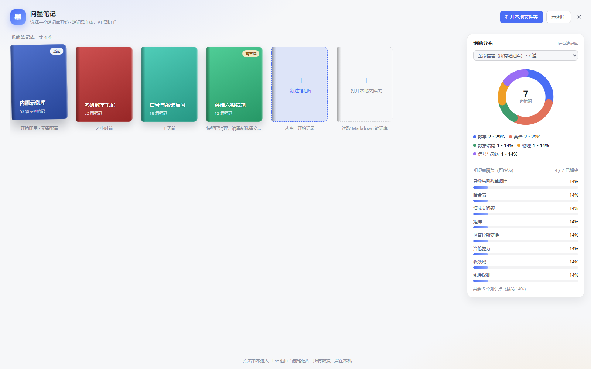
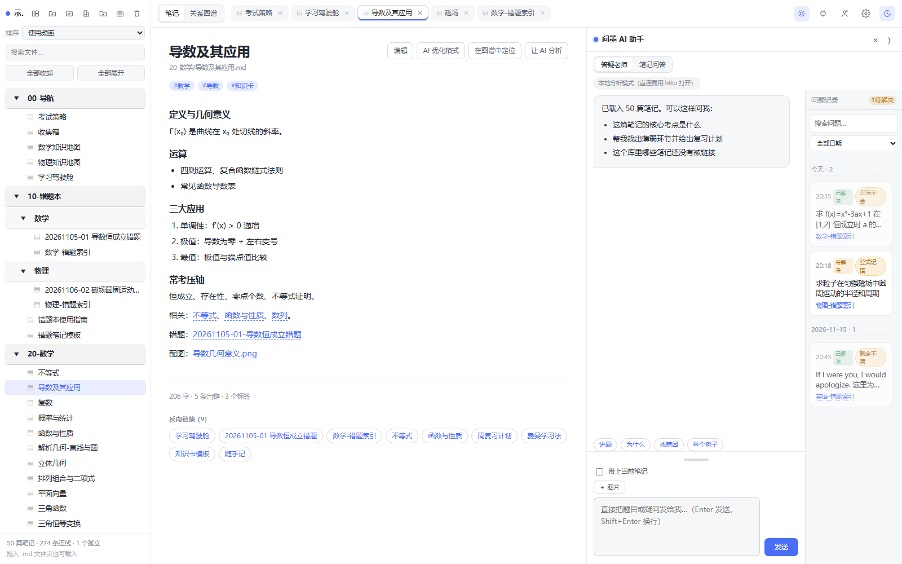
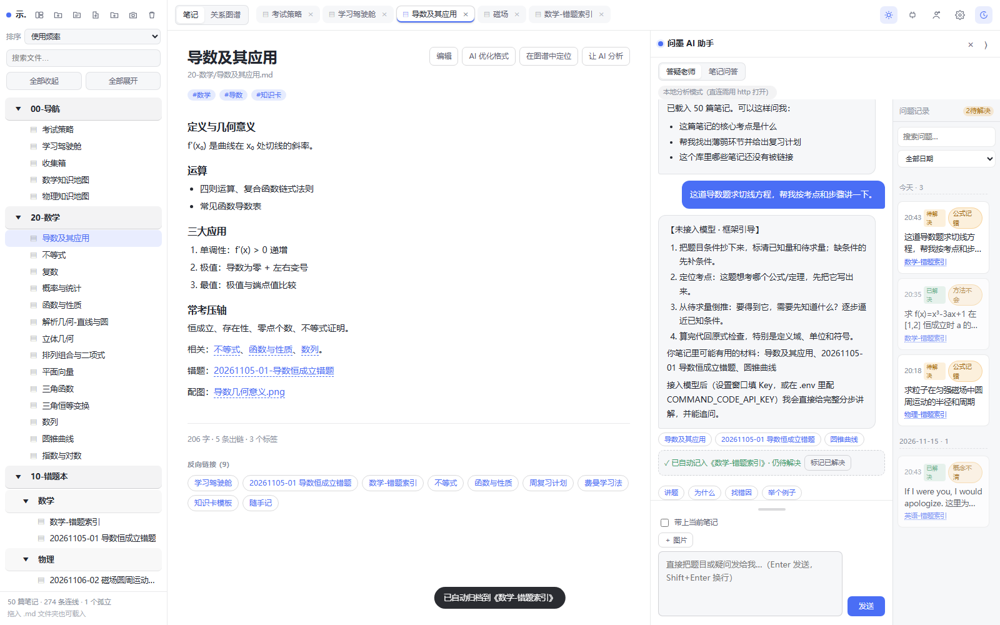
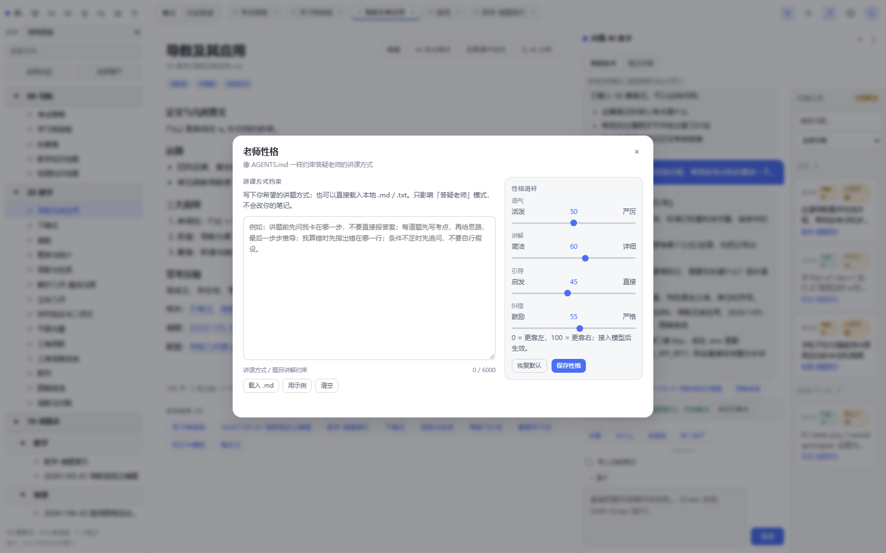
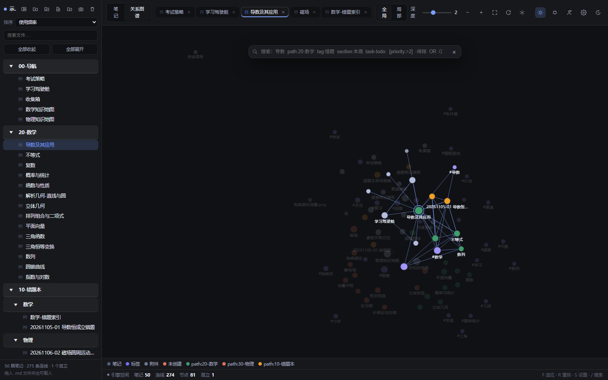

# 问墨笔记 · 项目介绍文档

> **一句话定位：问墨笔记，是一个会回答问题的本地 AI 笔记工作台。**
>
> 参赛赛事：2026 第九届传智杯全国大学生数智创新与 AI 应用大赛 · AI 创新应用挑战赛  
> 文档版本：v2.0（基于 2026-11-17 当前代码重新分析）  
> 项目状态：69 次 Git 提交；110 项自动化测试通过；省赛提交材料准备阶段

---

## 作品速览

| 项目 | 内容 |
| --- | --- |
| 作品名称 | 问墨笔记（Wenmo Notes） |
| 产品类型 | 本地优先的 AI 笔记学习工作台 |
| 核心用户 | 使用 Markdown 笔记的学生、备考者、自学者和知识管理用户 |
| 产品主线 | 笔记是主体，AI 答疑是特色，错题看板与关系图谱是辅助 |
| 技术底座 | HTML + CSS + 原生 JavaScript + Canvas 2D；Node.js 本地服务；无第三方运行时依赖 |
| AI 接入 | 本地代理 / 浏览器直连 / 纯本地分析三种模式；支持文本模型与视觉模型 |
| 核心闭环 | 笔记阅读编辑 → AI 答疑/拍题 → 单独分析学科、错题类型、知识点 → 完整原题归档 → 看板与复习定位 |
| 交付形态 | 单文件 HTML、Windows 单文件 exe、Electron 桌面版、本地服务窗口 |
| 数据格式 | 标准 Markdown 文件夹，支持 `[[双链]]`、`![[嵌入]]`、`#标签`、frontmatter |
| 当前阶段 | 2026 传智杯 AI 创新应用挑战赛省赛提交材料完善阶段 |

### 本次重点更新（2026-11-17）

| 更新项 | 当前实现 |
| --- | --- |
| 笔记库书架 | 启动进入“我的笔记库”，可管理多个库、重连本地文件夹、新建库、移入回收站并恢复 |
| 错题分布看板 | 按学科画环形图，按多知识点统计覆盖率，可按笔记库切换分析范围 |
| 数据隔离 | 问题记录、标签页、排序、使用频率、收藏均按笔记库分开 |
| 错题分析 | 答疑结束单独调用 AI/本地规则判定学科、错题类型和最多 5 个知识点 |
| 拍题入库 | 相机按钮选图，视觉模型识别题干后自动生成学科错题笔记；未配置视觉模型时明确拦截 |
| 老师性格 | 可载入 Markdown 讲课约束，用 4 根滑杆调节语气、讲解密度、引导方式和纠错风格 |
| AI 交互 | 新增图片按钮、Ctrl+V 粘贴图片、停止生成、无视觉模型时不硬发图片 |
| 图谱增强 | 节点右键菜单、更多文件操作；超过 360 个节点切换网格 + 远端质心近似 |
| 磁盘同步 | 授权本地文件夹后，编辑、新建、改名、删除可写回真实 Markdown 文件 |

---

## 一、项目详情及使用方式

### 1.1 背景与问题定义

学生的笔记、AI 问答和错题复习通常分散在三个工具里，导致：

1. AI 聊天中的讲解难以沉淀，过几天找不到；
2. 错题只剩知识点摘要，原题条件、问法和公式容易丢失；
3. 错题没有统一的学科入口，复习时无法按笔记库、学科和知识点查看；
4. 笔记工具与 AI 工具数据割裂，用户无法控制哪些内容被发送给模型；
5. 多库用户的记录、标签和复习状态容易串在一起。

问墨笔记把这些环节合并为一个本地优先的工作台：**读自己的 Markdown 笔记，问自己的问题，把完整问答沉淀为自己的错题资产，再用看板与图谱辅助复习。**

### 1.2 产品定位与用户场景

产品坚持三个原则：

- **笔记是主体**：进入页选择笔记库，工作区以文件树、整页阅读/编辑、笔记标签页为核心。
- **AI 是助手**：AI 面板常驻右侧，答疑老师负责讲题，笔记问答只依据已有笔记回答。
- **数据在本机**：默认不联网；本地服务只监听 `127.0.0.1`；模型密钥默认放服务端环境变量。

典型场景：

| 场景 | 使用流程 |
| --- | --- |
| 课后整理 | 打开笔记库 → 阅读/编辑笔记 → 向答疑老师提问 → 自动归档到学科错题本 |
| 错题复习 | 进入页查看错题分布 → 按库筛选 → 定位原题与解析 → 回到对应知识点笔记 |
| 拍照整理 | 点相机按钮选题目照片 → 视觉模型识别题干 → 生成学科错题笔记 |
| 多库管理 | 书架打开多个笔记库 → 各库记录、标签页、排序互相隔离 → 回收站恢复误移出的库 |
| 知识梳理 | 反向链接、关系图谱、查询语法、节点右键菜单 |
| 备份与扩展 | GitHub / Gitee / 百度网盘官方接口备份；插件注册命令、按钮和笔记挂件 |

### 1.3 核心功能闭环

```text
进入页选择笔记库
      ↓
文件树 / 多标签 / 所见即所得编辑 / 反向链接
      ↓
答疑老师（文本或图片）→ 分步讲解 / 多轮追问 / 可中断
      ↓
单独分析：学科 + 错题类型 + 多个知识点
      ↓
完整原题 + 解析 + 知识点标签写入学科错题本
      ↓
错题看板 / 日期搜索 / 定位原题 / 关系图谱 / 复习计划
```

### 1.4 功能一览

| 模块 | 已实现能力 |
| --- | --- |
| 进入页 | 多笔记库书架、封面哈希配色、最近打开时间、篇数、打开/新建/复制/改名/备份/删除、回收站恢复 |
| 错题看板 | 学科环形占比、知识点覆盖比例、已解决计数、按笔记库筛选、空状态 |
| 笔记 | 多级目录、全部展开/收起、多标签页、反向链接、任务列表、代码块、双链、标签 |
| 编辑 | 所见即所得、选区工具条、链接到笔记、AI 优化格式、`Ctrl+S` 即时保存 |
| 磁盘同步 | 授权文件夹后自动写回真实 `.md`；未连接磁盘时保存在本地快照 |
| AI 问答 | 答疑老师 / 笔记问答双人设、多轮追问、引用笔记、停止生成、历史会话隔离 |
| 图片问答 | 按钮选图、拖入、粘贴；最多 3 张；无视觉模型时明确提示，不硬发图片 |
| 拍题入库 | 单张题目图片识别为题目原文，自动建到学科错题目录，保留引用块原题 |
| 错题闭环 | 学科、错题类型、最多 5 个知识点；完整原题；去重；已解决；定位高亮 |
| 老师性格 | Markdown 讲课约束 + 活泼/严厉、简洁/详细、启发/直接、鼓励/严格四维滑杆 |
| 关系图谱 | 全局/局部、1–4 层、节点右键菜单、搜索语法、颜色分组、明暗主题 |
| 数据与安全 | 多库数据隔离、schema 迁移、本地服务白名单、Host/Origin 校验、Key 服务端化 |
| 扩展与备份 | 插件宿主、GitHub/Gitee/百度网盘官方接口快照备份 |

### 1.5 使用方式

**最快体验：单文件 HTML**

1. 双击 `dist/Wenmo-Notes.html`；
2. 在进入页选择“内置示例库”，或打开自己的 Markdown 文件夹；
3. 阅读、编辑、问答、图谱和本地分析无需安装 Node；只有调用模型时才需要配置接口。

**完整能力：本地服务 / 桌面窗口**

```text
双击：启动问墨笔记.bat
```

也可以手动启动：

```bash
npm install
node scripts/serve.mjs
# 浏览器打开 http://127.0.0.1:4321
```

其他交付形态：

| 形态 | 入口 | 特点 |
| --- | --- | --- |
| 桌面窗口 | `启动问墨笔记.bat` | 无地址栏独立窗口，完整 AI 与本地服务 |
| Windows exe | `dist/Wenmo-Notes.exe` | 内置 Node，目标机器无需安装 Node |
| Electron | `dist/Wenmo-Notes-Electron/Wenmo-Notes.exe` | 真桌面窗口，内置本地服务 |
| 单文件 HTML | `dist/Wenmo-Notes.html` | 零服务、可离线阅读与本地分析 |

**模型配置**

默认进入本地分析模式。启用模型时，推荐使用服务端代理，把 Key 放在 `.env` 或环境变量中，前端不接触 Key。文本模型用于问答，视觉模型用于图片问答和拍题入库；未配置视觉模型时应用会明确提示，不会把图片强行发给纯文本模型。

```bash
cp .env.example .env
# COMMAND_CODE_API_KEY=<YOUR_API_KEY>
# AI_MODEL=<YOUR_TEXT_MODEL>
# AI_VISION_MODEL=<YOUR_VISION_MODEL>
node scripts/serve.mjs
```

**日常流程**

1. 进入页选择笔记库；
2. 左侧文件树打开笔记，顶部标签页切换；
3. 右栏选择“答疑老师”提问，或点相机按钮拍题；
4. 答疑结束后系统单独分析学科、错题类型和知识点；
5. 自动写入 `10-错题本/<学科>/`，原题与解析完整保留；
6. 在问题记录中搜索、按日期筛选、定位原题；
7. 回到进入页查看错题看板，或用关系图谱梳理知识结构。

### 1.6 复现命令

```bash
npm test          # 110 项自动化测试
npm run build     # 生成单文件 dist/Wenmo-Notes.html
npm run smoke     # 源码 + 单文件产物冒烟测试
npm run serve     # 本地服务，默认 4321
npm run build:exe
npm run build:electron
```

---

## 二、项目亮点

### 亮点 1：从“单库笔记本”升级为真正的多库工作台

进入页把每个笔记库做成一本书，显示篇数、最近打开时间和状态。打开过的本地文件夹会记住句柄，下一次可申请权限重连；新建库会直接生成欢迎页和错题本说明；误移出的库进入回收站，可恢复或彻底删除。与单纯“打开一个文件夹”相比，多库书架更接近长期使用的桌面软件。

### 亮点 2：错题看板把“记录”变成可观察的复习数据

进入页右侧常驻错题分布看板：

- 按学科绘制环形占比图；
- 按多知识点统计覆盖率，一道题有几个知识点就分别计入；
- 显示“已解决 / 总数”；
- 可按所有笔记库或单个笔记库重算；
- 没有记录时给出明确引导，而不是空白面板。

这让错题本从“写了但很少回看”变成进入应用第一眼就能看到的复习仪表盘。

### 亮点 3：错题闭环更完整，也更具体

答疑结束后，系统会单独做一次分析，而不只依赖回答文本：

- **学科**：数学、物理、化学、生物、英语、语文、数据结构、信号与系统等；
- **错题类型**：概念不清、计算失误、审题偏差、方法不会、公式记错、步骤遗漏、其他；
- **知识点**：最多 5 个，统一清洗为 `#标签`，供图谱和查询分类；
- **完整原题**：以引用块原样保留换行、多问和公式；
- **去重与状态**：同一道题不重复写入，可标记已解决；
- **定位**：从问题记录直接跳到错题本中的对应段落。

### 亮点 4：图片问答与拍题入库形成两条真实入口

- 日常答疑时可按钮选图、拖拽或 `Ctrl+V` 粘贴，最多 3 张；
- 没有视觉模型时明确提示“图片不会被发送”，不再用纯文本模型硬碰 400；
- 拍题入库只负责识别题目原文，不把“识题”和“解题”混在一起；
- 识别结果自动建立为学科错题笔记，并把原题放在引用块中，后续可继续追问。

### 亮点 5：老师性格可配置，不是一句固定 Prompt

设置左侧的“老师性格”支持：

- 载入自己的 `.md` 讲课约束；
- 四根滑杆分别控制语气、讲解密度、引导方式和纠错风格；
- 保存后编译进答疑老师的系统提示词；
- 代理模式和直连模式生效，本地模式只保存，接入模型后使用。

它把“AI 讲得像不像我的老师”从黑盒提示词变成了可调整、可复现的产品配置。

### 亮点 6：笔记是主体，编辑与数据都落到真实 Markdown

- 所见即所得编辑：选中文字即可加粗、斜体、下划线、高亮、链接笔记或清除格式；
- 授权本地文件夹后，修改会同步写回真实 `.md` 文件；
- 多标签页、侧栏和 AI 面板可拖动调宽；
- 反向链接、双链、标签和关系图谱由真实笔记内容生成；
- 单文件 HTML、Windows exe、Electron 三种交付形态共用同一套前端与本地服务。

### 亮点 7：本地优先的安全边界

- 默认不联网，没有 Key 时只走本地规则分析；
- 本地服务只监听 `127.0.0.1`；
- 静态资源白名单、Host/Origin 校验、JSON Content-Type 校验；
- 页面设置 CSP、`nosniff`、`no-referrer`；
- Key 默认从环境变量/`.env` 读取，只在服务端内存中使用；
- `.gitignore` 排除 `.env`、私钥、凭据文件与本地数据。

### 亮点 8：AI 协同开发有过程证据

项目从 44 次提交迭代到 69 次提交，`docs/PROMPT-LOG.md` 记录了 43 条 Prompt 链。近期链路覆盖：

- 多库书架、错题看板和笔记库数据隔离；
- 笔记库回收站与老记录归属修复；
- 拍题入库、图片按钮与无视觉模型守卫；
- 错题类型单独判定、知识点标签化与多知识点统计；
- 数学/物理/化学/语文学科误判修复；
- 大图网格近似与 500 节点测试。

这些记录保留了失败、返工和验收，不把“一次生成”当作过程。

---

## 三、AI 测试技术落地情况

### 3.1 测试结构

| 层级 | 目标 | 当前做法 |
| --- | --- | --- |
| 逻辑单测 | 数据、解析、查询、物理、富文本、存储 | Node 原生 `node:test`，110 项断言 |
| AI 合同测试 | 文本/视觉接口、人设、老师性格、结构化学科分析 | 本地模拟 OpenAI 兼容上游，不依赖真实 Key |
| 端到端冒烟 | 用户主流程和新功能 | jsdom 加载源码与单文件产物，执行真实 DOM 事件 |
| 安全回归 | 本地服务与敏感路径 | 静态白名单、Host/Origin、Content-Type、凭据不渲染 |
| 人工视觉验收 | 首屏、布局、暗色主题与状态 | 当前构建产物实机截图 |

### 3.2 新增功能对应的测试

| 功能 | 验证点 |
| --- | --- |
| 进入页书架 | 示例库可见、可新建库、书本可进入、可右键管理 |
| 笔记库回收站 | 删除进回收站、可恢复、示例库不允许删除 |
| 多库隔离 | 记录按 `vaultId` 分开，切库不串记录；老记录按目标路径修复 |
| 错题看板 | 环形图扇区、百分比合计 100%、知识点比例、按库筛选、空状态 |
| 老师性格 | 四根滑杆、Markdown 约束、系统提示词中包含自定义性格、恢复默认 |
| 图片入口 | 图片按钮、粘贴/拖入生成缩略图、无视觉模型时不硬发图片 |
| 拍题入库 | 图片 API 存在、本地模式明确拦截、成功后生成题目笔记 |
| 错题分析 | 学科、错题类型、多个知识点、完整原题、去重、定位 |
| AI 中断 | 生成中出现停止按钮、点击后请求 abort、不写问题记录 |
| 大图性能 | 500 节点推进后坐标有限，网格与远端质心近似不产生 NaN |

### 3.3 本次实际复验

复验日期：2026-11-17。执行：

```bash
npm test
npm run smoke
node scripts/build-app.js --check
node scripts/build-ai.js --check
```

结果：

- `npm test`：**110 项通过，0 失败，0 跳过**；
- `npm run smoke`：**退出码 0，`errors` 为空数组**；
- 示例库：50 篇笔记、3 个附件、27 个标签、274 条链接、1 篇孤立笔记；
- 冒烟装配：80 个节点、273 条可见连线；
- 单文件产物：外部脚本 0 个、内联样式 1 份，加载无错误；
- 冒烟覆盖了书架、回收站、错题看板、老师性格、拍题入口、错题类型、多知识点、多库隔离、AI 中断等新增流程；
- 页面 DOM 不包含测试 Key，真实凭据不进入前端。

### 3.4 AI 协同开发中的真实返工

项目中保留了多条真实失败链：

- 图片拖入曾被全局文件拖放监听劫持，触发整库载入；
- 纯文本模型收到图片内容块会返回 400，后来改为“无视觉模型时只发文字并明确提示”；
- 数学极限题曾被判成英语/数据结构，后来收紧英语判定、替换过泛关键词并补数学词表；
- 物理学科词表中的裸“力/电/磁”会抢走化学电解和语文病句，后来改成具体词组；
- 错题记录曾因缺少 `vaultId` 被归到别的库，后来按 `targetPath` 反查并修复；
- 笔记库删除曾直接消失，后来改为回收站。

这些修复都对应测试或冒烟断言，而不是只改界面文案。

### 3.5 仍需补的测试

- 真实大模型答案正确率、引用准确率、幻觉率和平均时延尚无标准题集；
- 视觉模型的真实识别准确率、公式转写准确率和多题切分尚未做大规模评测；
- 1000+ 节点图谱仍需要实际帧率和首屏时间基准；
- 多窗口同时写问题记录时的并发一致性仍需专项测试；
- 浏览器兼容性以 Edge/Chrome 为主，Firefox/Safari 需要更多实测。

---

## 四、关键技术

### 4.1 数据层：Markdown → 图模型

`js/vault.js` 解析 frontmatter、双链、别名、嵌入、标签、附件和未创建链接，生成笔记、标签、附件和解析不到的虚节点。`js/query.js` 实现 `path:`、`file:`、`tag:`、`content:`、`section:`、`line:`、`block:`、`task:`、属性比较、排除、`OR` 与正则查询。

### 4.2 力导向图与 Canvas 2D

`js/physics.js` 使用 FNV-1a 哈希生成确定性初始位置，组合排斥力、弹簧力、中心引力、阻尼和网格碰撞。小图使用精确两两排斥；超过 360 个节点切换到 3×3 网格 + 远端质心近似，500 节点测试仍保持有限坐标。`js/render.js` 负责视口变换、邻居高亮、标签避让、缩放淡出与暗色主题。

### 4.3 多库书架与数据隔离

`js/app/07-vault-library.js` 管理书架条目、IndexedDB 文件夹句柄、快照、回收站和启动进入页；`js/app/09-launcher-stats.js` 从问题记录生成学科占比和多知识点覆盖率。记录、标签页、排序、使用频率和收藏都按 `@库ID` 分桶，避免跨库串数据。

### 4.4 所见即所得编辑与磁盘同步

`js/richtext.js` 完成 HTML ⇄ Markdown 往返；`js/app/08-disk-sync.js` 使用 File System Access API 把改动写回真实文件。浏览器未授权时退回本地快照，桌面服务模式则保留完整的本地数据路径。

### 4.5 AI 服务层与结构化分析

`scripts/server-core.cjs` 统一提供 `/api/chat`、`/api/analyze`、`/api/models`、`/api/health`、记录和百度网盘接口：

- 文本模型与视觉模型分开配置；
- 答疑老师、笔记问答、格式整理和错题分析使用不同 system prompt；
- `/api/analyze` 只输出 JSON，返回学科、最多 5 个知识点和固定错题类型；
- 直连模式在没有本地服务时直接用同一个模型 Key 完成分析；
- 无 Key 或接口异常时自动回退本地规则。

### 4.6 拍题入库

`js/app/12-photo.js` + `ai.recognizeImage()`：

```text
题目图片
  ↓
视觉模型只识别题干/选项/公式，不解答
  ↓
本地按学科建立 10-错题本/<学科>/ 笔记
  ↓
原题以 Markdown 引用块保留
  ↓
用户继续追问 AI 或手工补错因
```

未配置视觉模型时直接拦截，不产生一次“假识别”。

### 4.7 老师性格编译

`js/ai/10-model.js` 把自填 Markdown 约束与四根滑杆转换为文本规则，拼到答疑老师的 system prompt 中；`js/app/60-prefs.js` 负责载入 `.md`、保存、恢复默认和状态提示。这样既能保留固定教学结构，又能让用户调整讲课风格。

### 4.8 本地存储与迁移

`js/store.js` 统一管理 schema 版本、分库键和旧数据迁移。问题记录同时存在 localStorage 与本地服务 `data/records.json`，启动时按 id 合并；旧版平铺错题本会迁入学科子目录；旧 `race-ainote:` 前缀保留以兼容历史数据。

### 4.9 安全边界与多端构建

本地服务只绑定 `127.0.0.1`，静态资源白名单只开放页面、样式和 `js/**`；API 校验 Host、Origin 与 JSON Content-Type；页面设置 CSP 与安全响应头。`scripts/build.js` 生成单文件 HTML，`build-exe.js` 使用 Node SEA，`build-electron.js` 生成 Electron 应用，三端共用同一份 `server-core.cjs`。

### 4.10 扩展与备份

插件可注册命令、工具栏按钮、笔记挂件和事件回调，使用独立存储命名空间；云备份只对接 GitHub Contents API、Gitee OpenAPI v5 和百度网盘开放接口，不做无官方接口的逆向方案。

---

## 五、项目相关图片

以下图片来自当前构建产物，以 1600×1000 视口在浏览器中实际运行后截取。



**图 1**：进入页。每个笔记库是一本书，右侧看板展示错题学科占比、知识点覆盖和已解决进度，并支持按库筛选。



**图 2**：笔记主视图。顶部保留多篇笔记标签，中间是阅读区，左侧为多级目录，右侧为 AI 助手与问题记录。



**图 3**：答疑老师与问题记录。回答完成后自动分析并准备错题归档；问题记录保留完整问答和状态。



**图 4**：老师性格设置。可载入 Markdown 讲课约束，并用语气、讲解、引导、纠错四根滑杆调整风格。



**图 5**：关系图谱暗色主题。双链自动生成节点和连线，支持搜索、筛选、拖拽、缩放和节点右键操作。

> 截图中的示例库、错题记录和模型配置均为演示状态，不包含真实 API Key、账号密码或个人隐私数据。

---

## 六、发表或获奖情况

截至 2026-11-17：

- **本项目从未公开发表过论文、文章或作品**；
- **本项目没有获得过任何奖项，不是获奖作品**；
- 项目材料中暂无专利、软件著作权等证明；
- 本项目仅为 2026 第九届传智杯全国大学生数智创新与 AI 应用大赛 · AI 创新应用挑战赛参赛作品，处于省赛提交材料完善阶段，尚未评审、未获任何奖项。

正式表述：**未公开发表、未获得任何奖项，仅报名参赛。** 后续如取得论文、软著、专利或赛事奖项，必须凭真实证明再更新。

---

## 七、在其他项目基础上的优化说明

问墨笔记是原创项目，**不是基于某个现成开源笔记项目或 AI 应用二次包装**。项目没有复制第三方业务代码；前端不依赖 React/Vue、D3、Obsidian 插件 API 或第三方图谱库。Markdown 解析、查询 DSL、力导向、Canvas 渲染、AI 服务、错题归档与构建脚本均由本项目实现并配有测试。

项目的起点是 `PROMPT.md` 中“零依赖复刻关系图谱”的单功能原型；后续根据真实学习场景逐步调整产品重心：

| 阶段 | 优化方向 |
| --- | --- |
| 产品定位 | 关系图谱展示器 → 笔记主体 + AI 答疑 + 图谱辅助 |
| AI 能力 | 单一问答 → 双人设、多轮、图片、老师性格、停止生成、本地降级 |
| 学习闭环 | 回答完成即结束 → 学科/错题类型/多知识点分析、完整原题、去重、定位 |
| 数据管理 | 单库缓存 → 书架多库、IndexedDB 句柄、回收站、分库隔离、错题看板 |
| 笔记编辑 | 文本编辑 → 所见即所得、选区工具条、链接笔记、磁盘回写、多标签页 |
| 图谱 | 基础视图 → 高级查询、节点右键菜单、大图网格近似、暗色主题 |
| 交付 | 开发页面 → 单文件 HTML、SEA exe、Electron、统一图标与启动方式 |

历史兼容方面，项目保留了旧 `race-ainote:` localStorage 前缀，旧错题记录会迁移到学科子目录，旧版笔记库记录会按目标路径修复归属。

---

## 八、当前限制与后续计划

### 8.1 已知限制

- AI 答案质量依赖所接入模型；正确率、幻觉率、时延和成本尚未建立真实模型基准；
- 拍题入库目前是“单张图片 → 一道题笔记”的半自动流程，多题切分、公式转写和复杂排版仍需真实题集评测；
- 没有配置视觉模型时，图片不会发送，拍题入库会被明确拦截；
- 超过 360 个节点的图谱使用近似排斥，1000+ 节点仍需实际性能压测；
- 问题记录的多窗口并发写入和服务端增量合并仍需专项完善；
- 云同步是快照备份，不含附件，不是实时协作；
- 插件拥有页面同权限，不是安全沙箱；
- 本地文件夹写回依赖浏览器授权，重要笔记建议同时使用 Git 或备份。

### 8.2 下一步计划

1. 建立 30–50 道多学科黄金题集和 10–20 道图片题测试集，评估答案、引用和识图准确率；
2. 补多题切分、公式转写、拍题校对和人工确认流程；
3. 建立 500/1000/3000 节点图谱性能基准，决定是否升级到更激进的近似算法；
4. 为问题记录增加按 id 的增量 upsert，避免多窗口覆盖；
5. 完成演示视频、公开仓库链接、原始 Prompt 证据和最终 PDF 材料；
6. 提交前复查 `.env`、token、私钥、密码、Cookie 等敏感信息，确保全部走环境变量且不进入仓库。

---

## 九、结论

问墨笔记已经从一个关系图谱原型，发展为可日常使用的本地 AI 学习工作台：

- **对用户**：多库书架、真实 Markdown、AI 答疑、拍题、错题类型、知识点标签和错题看板构成完整复习链路；
- **对评审**：功能不是外壳，既有可运行产物，也有 110 项测试、43 条 Prompt 链、69 次提交和清晰的工程分层；
- **对工程**：零运行时依赖、服务端密钥边界、多端交付、本地数据隔离和自动降级都已经落地。

项目当前不虚构获奖或论文，也不把尚未完成的多题 OCR 与真实模型准确率包装成已解决。下一阶段应优先补齐真实模型评测、拍题质量、并发一致性和参赛材料闭环，再进入最终提交。

---

## 附录：复现与证据索引

| 材料 | 位置 / 命令 |
| --- | --- |
| 项目说明与 10 分钟复现 | `README.md` |
| 原始功能规格 | `PROMPT.md` |
| 立项可行性分析 | `可行性分析.md` |
| 架构说明 | `docs/ARCHITECTURE.md` |
| Prompt 链快照（43 条） | `docs/PROMPT-LOG.md` |
| 单元测试 | `npm test` |
| 源码 + 单文件冒烟 | `npm run smoke` |
| 构建单文件 | `npm run build` |
| 构建 Windows exe | `npm run build:exe` |
| 构建 Electron | `npm run build:electron` |
| 品牌图标 | `assets/` |
| 本版界面截图 | `项目介绍配图/` |

> 仓库地址、最终公开链接和演示视频链接应在提交前按赛事平台要求确认；不要把真实 Key、token、私钥、密码或个人凭据写入本文件或提交到 Git 仓库。
